# New session - 2026-10-26T21:07:52.911Z

**Session ID:** ses_e85f57830ffesI3Gb2JH7s3v5z
**Created:** 10/26/2026, 9:07:52 PM
**Updated:** 10/26/2026, 9:10:19 PM

---

## User

so look at this code, do you think you can do a better design ? really gorgeous and very nice at the same time  being commnuicative ?i have put some context for the pricing page in a pricingcontext.txt also i have put a video that should be on the homepage in a video folder. also an image i named pricing image to help with the pricing page as well. lets see your best work

---

## Assistant (Build · Big Pickle · 31.7s)

Let me look at the codebase, assets, and pricing context first.


**Tool: read**

**Input:**
```json
{
  "filePath": "/home/joe/Desktop/projects/junktitan/junkdes"
}
```

**Output:**
```
<path>/home/joe/Desktop/projects/junktitan/junkdes</path>
<type>directory</type>
<entries>
contact.html
images/
index.html
location.html
pricing.html
pricing/
pricingcontext.txt
service.html
styles.css
videos/

(10 entries)
</entries>
```

**Tool: read**

**Input:**
```json
{
  "filePath": "/home/joe/Desktop/projects/junktitan/junkdes/pricingcontext.txt"
}
```

**Output:**
```
<path>/home/joe/Desktop/projects/junktitan/junkdes/pricingcontext.txt</path>
<type>file</type>
<content>
1: Pricing
2: All-inclusive pricing
3: We charge by volume, which is how much space your items take up in the truck. We have a minimum charge for very small loads; from there, prices go from 1/8th of a truck up to a full truckload. We also have special pricing if you only have one single item. We can give you an exact price once we see the items in person.
4: 
5: Pricing Image
6: Single Item Removal Price
7: When you have only one item to remove, Junk Titanic Prices are based on the size. (For example, a single wardrobe would cost more than a microwave.) If you have more than 1 item, your price is based on truck volume.
8: 
9: Examples of pieces with single-item prices:
10: Small appliances (microwave, toaster oven, etc)
11: Computer/computer monitor
12: Any size mattress (single, double or king-size)
13: Any appliance (washing machine, dryer, BBQ grill, etc.)
14: Any furniture (sofa, bed frame, dining table, sofa bed etc.)
15: Any type of TV
16: Exercise Equipment (treadmill, elliptical trainers, trampoline etc.)
17: Single Item Removal
18: For multiple items? We price by volume.
19: It’s based on how much space your junk takes up in the truck. We have a minimum charge for very small loads; from there, prices go from 1/8th of a truck up to a full truckload. We can give an exact price when we see the items on site.
20: 
21: Our trucks hold roughly two tons of junk, which is the same as:
22: Twice 8 cubic yards — equivalent to 2 standard domestic skips
23: Or, four full-sized three-seater sofas
24: Volume Pricing

(End of file - total 24 lines)
</content>
```

---

## Assistant (Build · Big Pickle · 5.3s)

**Tool: read**

**Input:**
```json
{
  "filePath": "/home/joe/Desktop/projects/junktitan/junkdes/index.html"
}
```

**Output:**
```
<path>/home/joe/Desktop/projects/junktitan/junkdes/index.html</path>
<type>file</type>
<content>
1: <!DOCTYPE html>
2: <html lang="en-GB">
3: <head>
4:   <meta charset="UTF-8" />
5:   <meta name="viewport" content="width=device-width, initial-scale=1" />
6:   <title>Rubbish Removal & House Clearance Scotland | Junk Titanic</title>
7:   <meta name="description" content="Fast, reliable rubbish removal, house clearance & waste collection across Central Scotland. Same-day service, upfront pricing. Call 07825 646222." />
8:   <link rel="stylesheet" href="styles.css" />
9: </head>
10: <body>
11: 
12:   <!-- ============ HEADER ============ -->
13:   <header class="site-header" role="banner">
14:     <div class="container header-inner">
15:       <a href="index.html" class="logo" aria-label="Junk Titanic home">
16:         
17:       </a>
18: 
19:       <nav class="main-nav" aria-label="Primary">
20:         <ul>
21:           <li><a href="service.html">Rubbish Removal</a></li>
22:           <li><a href="service.html">House Clearance</a></li>
23:           <li><a href="service.html">Commercial</a></li>
24:           <li><a href="pricing.html">Pricing</a></li>
25:           <li><a href="service.html">What We Take</a></li>
26:           <li><a href="location.html">Areas</a></li>
27:         </ul>
28:       </nav>
29: 
30:       <div class="header-actions">
31:         <a class="btn btn-ghost" href="tel:07825646222">07825 646222</a>
32:         <a class="btn btn-wa" href="https://wa.me/447825646222" target="_blank" rel="noopener">
33:           WhatsApp a photo
34:         </a>
35:         <button class="nav-toggle" aria-label="Open menu" aria-expanded="false" aria-controls="mobile-nav">☰</button>
36:       </div>
37:     </div>
38: 
39:     <nav id="mobile-nav" class="mobile-nav" aria-label="Mobile" hidden>
40:       <ul>
41:         <li><a href="service.html">Rubbish Removal</a></li>
42:         <li><a href="service.html">House Clearance</a></li>
43:         <li><a href="service.html">Commercial Waste</a></li>
44:         <li><a href="service.html">Office Clearance</a></li>
45:         <li><a href="pricing.html">Pricing</a></li>
46:         <li><a href="service.html">What We Take</a></li>
47:         <li><a href="location.html">Areas We Cover</a></li>
48:         <li><a href="service.html">FAQs</a></li>
49:         <li><a href="contact.html">Contact</a></li>
50:       </ul>
51:     </nav>
52:   </header>
53: 
54:   <main>
55: 
56:     <!-- ============ HERO ============ -->
57:     <section class="hero">
58:       <div class="container hero-grid">
59:         <div class="hero-copy">
60:           <p class="eyebrow">SEPA-registered · Fully insured · Same-day possible</p>
61:           <h1>Rubbish gone. Space back. Done right.</h1>
62:           <p class="lede">
63:             Professional rubbish removal and house clearance across Glasgow, Edinburgh,
64:             Stirling, Livingston and Scotland's Central Belt. Upfront pricing, uniformed
65:             crew, and responsible recycling — we broom-sweep before we leave.
66:           </p>
67:           <div class="cta-row">
68:             <a class="btn btn-wa btn-lg" href="https://wa.me/447825646222" target="_blank" rel="noopener">
69:               📷 Send a photo on WhatsApp
70:             </a>
71:             <a class="btn btn-primary btn-lg" href="tel:07825646222">
72:               📞 Call 07825 646222
73:             </a>
74:           </div>
75:           <ul class="trust-strip" aria-label="Trust signals">
76:             <li>SEPA registered</li>
77:             <li>Fully licensed &amp; insured</li>
78:             <li>Same-day where possible</li>
79:             <li>Upfront, all-inclusive price</li>
80:           </ul>
81:         </div>
82: 
83:         <div class="hero-media">
84:           <div class="hero-visual" role="img" aria-label="Junk Titanic crew clearing rubbish from a property in Glasgow">
85:             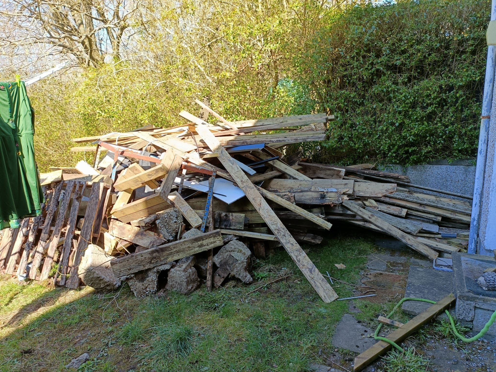
86:             <div class="hero-badge">
87:               <strong>Same-day</strong>
88:               <span>Waste removed, site swept, no hassle.</span>
89:             </div>
90:           </div>
91:         </div>
92:       </div>
93:     </section>
94: 
95:     <!-- ============ HOW IT WORKS ============ -->
96:     <section class="section" id="how">
97:       <div class="container">
98:         <header class="section-head">
99:           <h2>Three steps. That's it.</h2>
100:           <p>No skip hire. No tip runs. No heavy lifting.</p>
101:         </header>
102:         <ol class="steps">
103:           <li>
104:             <span class="step-num" aria-hidden="true">1</span>
105:             <h3>Send a photo</h3>
106:             <p>WhatsApp us a picture of what needs to go. We reply with a competitive quote — often within minutes.</p>
107:           </li>
108:           <li>
109:             <span class="step-num" aria-hidden="true">2</span>
110:             <h3>Get an upfront price</h3>
111:             <p>All-inclusive, before we lift a finger. Prefer a site visit? We'll pop over and quote on the spot.</p>
112:           </li>
113:           <li>
114:             <span class="step-num" aria-hidden="true">3</span>
115:             <h3>We clear &amp; sweep</h3>
116:             <p>Our uniformed crew loads everything, sweeps up, and takes payment. You point — we do the rest.</p>
117:           </li>
118:         </ol>
119:       </div>
120:     </section>
121: 
122:     <!-- ============ SERVICES ============ -->
123:     <section class="section section-alt" id="services">
124:       <div class="container">
125:         <header class="section-head">
126:           <h2>What we clear</h2>
127:           <p>Homes, gardens, offices and sites across Central Scotland.</p>
128:         </header>
129:         <div class="cards">
130:           <a class="card" href="service.html">
131:             <div class="card-thumb">
132:               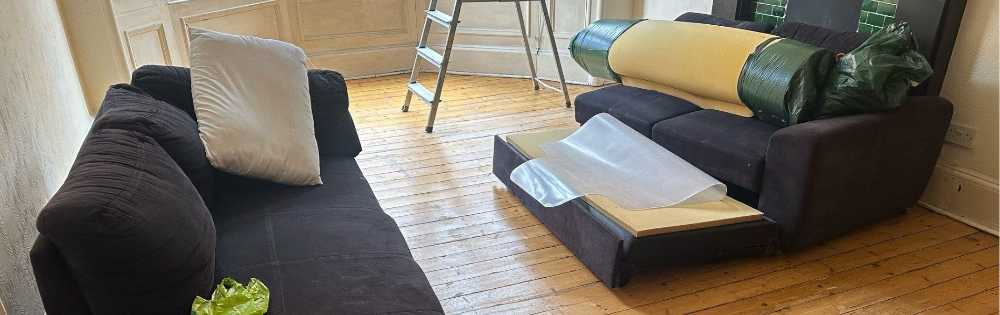
133:             </div>
134:             <h3>House Clearance</h3>
135:             <p>Full or partial clears — moving, downsizing, bereavement, rental turnover.</p>
136:             <span class="card-link">Learn more →</span>
137:           </a>
138:           <a class="card" href="service.html">
139:             <div class="card-thumb">
140:               
141:             </div>
142:             <h3>Rubbish Removal</h3>
143:             <p>Bulky items, appliances, furniture and general household junk.</p>
144:             <span class="card-link">Learn more →</span>
145:           </a>
146:           <a class="card" href="service.html">
147:             <div class="card-thumb">
148:               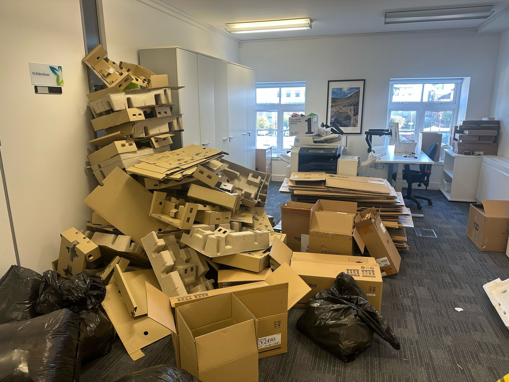
149:             </div>
150:             <h3>Commercial &amp; Office</h3>
151:             <p>Desks, IT, confidential shredding, fit-out debris — minimal disruption.</p>
152:             <span class="card-link">Learn more →</span>
153:           </a>
154:           <a class="card" href="service.html">
155:             <div class="card-thumb">
156:               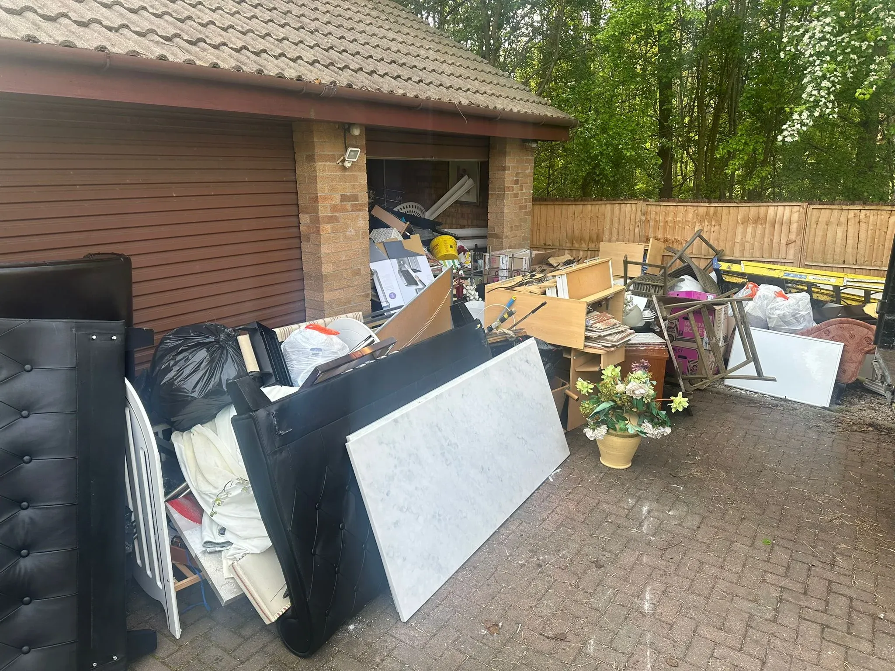
157:             </div>
158:             <h3>Garden Clearance</h3>
159:             <p>Sheds, decking, fencing, green waste and outdoor clutter.</p>
160:             <span class="card-link">Learn more →</span>
161:           </a>
162:           <a class="card" href="service.html">
163:             <div class="card-thumb">
164:               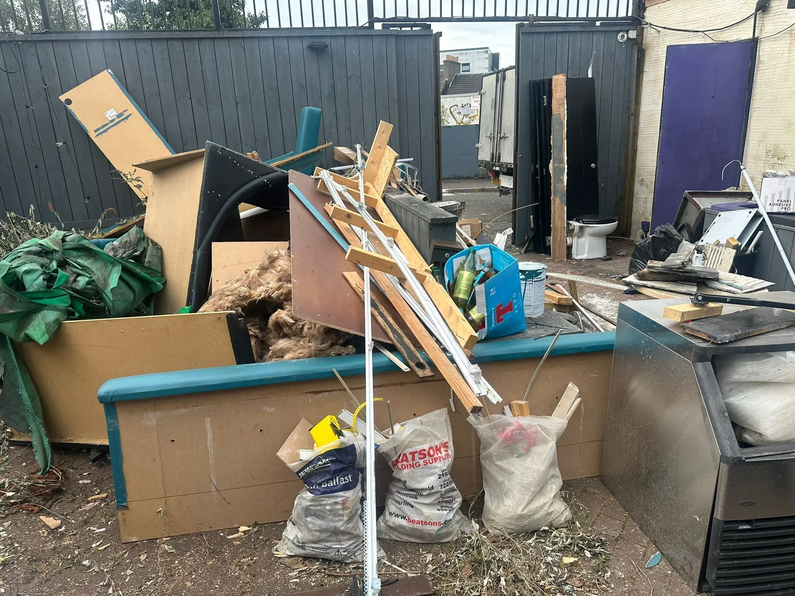
165:             </div>
166:             <h3>Construction &amp; Renovation</h3>
167:             <p>Plasterboard, timber, rubble, kitchen and bathroom rip-outs.</p>
168:             <span class="card-link">Learn more →</span>
169:           </a>
170:           <a class="card" href="service.html">
171:             <div class="card-thumb">
172:               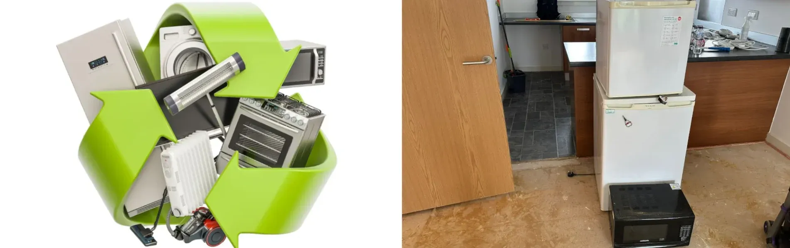
173:             </div>
174:             <h3>Recycling &amp; WEEE</h3>
175:             <p>White goods, electronics, UPVC and office furniture — recycled responsibly.</p>
176:             <span class="card-link">Learn more →</span>
177:           </a>
178:         </div>
179:       </div>
180:     </section>
181: 
182:     <!-- ============ WHY US ============ -->
183:     <section class="section" id="why">
184:       <div class="container">
185:         <header class="section-head">
186:           <h2>Why choose Junk Titanic</h2>
187:         </header>
188:         <div class="pillars">
189:           <div class="pillar">
190:             <h3>Upfront pricing</h3>
191:             <p>All-inclusive price confirmed before we uplift. No surprises, no hidden fees.</p>
192:           </div>
193:           <div class="pillar">
194:             <h3>Clean service</h3>
195:             <p>We broom-sweep afterwards and take payment on completion. You'd never know we were there — except the space is clear.</p>
196:           </div>
197:           <div class="pillar">
198:             <h3>Eco-friendly</h3>
199:             <p>SEPA-registered. We recycle as much as possible, donate reusable items to charity, and divert waste from landfill.</p>
200:           </div>
201:           <div class="pillar">
202:             <h3>Professional team</h3>
203:             <p>Uniformed, trained and fully insured operatives. Trained lifting, proper equipment, courteous service.</p>
204:           </div>
205:         </div>
206:       </div>
207:     </section>
208: 
209:     <!-- ============ WHAT WE TAKE ============ -->
210:     <section class="section section-alt" id="take">
211:       <div class="container">
212:         <header class="section-head">
213:           <h2>What we take — and what we can't</h2>
214:           <p>If it's non-hazardous and controlled waste, we can almost certainly clear it.</p>
215:         </header>
216:         <div class="two-col">
217:           <div>
218:             <h3 class="list-yes">✓ We take</h3>
219:             <ul class="check-list">
220:               <li>Furniture — sofas, wardrobes, beds, mattresses</li>
221:               <li>Appliances — washing machines, fridges, cookers</li>
222:               <li>Electronics &amp; IT — TVs, monitors, printers</li>
223:               <li>Garden waste — shrubs, fencing, sheds</li>
224:               <li>Construction debris — plasterboard, timber, rubble</li>
225:               <li>Office clearances — desks, chairs, confidential paper</li>
226:               <li>General household clutter and bric-a-brac</li>
227:             </ul>
228:           </div>
229:           <div>
230:             <h3 class="list-no">✗ We can't take</h3>
231:             <ul class="x-list">
232:               <li>Chemicals</li>
233:               <li>Asbestos</li>
234:               <li>Oil drums &amp; storage tanks</li>
235:               <li>Anything hazardous or restricted</li>
236:             </ul>
237:             <p class="note">Not sure? Call us — our team will advise on safe disposal routes.</p>
238:           </div>
239:         </div>
240:       </div>
241:     </section>
242: 
243:     <!-- ============ AREAS ============ -->
244:     <section class="section" id="areas">
245:       <div class="container">
246:         <header class="section-head">
247:           <h2>Areas we cover</h2>
248:           <p>Across Scotland's Central Belt — and beyond, by arrangement.</p>
249:         </header>
250: 
251:         <div class="areas-grid">
252:           <div>
253:             <h3>Glasgow &amp; surrounding</h3>
254:             <p>City Centre · West End · East End · Southside · Bearsden · Milngavie · Paisley · Renfrew · East Kilbride · Clydebank</p>
255:           </div>
256:           <div>
257:             <h3>Edinburgh &amp; Lothians</h3>
258:             <p>City Centre · Leith · Morningside · Livingston · Musselburgh · Dalkeith · Penicuik</p>
259:           </div>
260:           <div>
261:             <h3>Other key areas</h3>
262:             <p>Stirling · Falkirk · Dunfermline · Kilmarnock · Ayr · Hamilton · Cumbernauld · Motherwell · Loch Lomond</p>
263:           </div>
264:         </div>
265: 
266:         <div class="areas-media">
267:           <!-- MEDIA: map graphic — alt="Map of Junk Titanic service area across Central Scotland" -->
268:           <div class="media-ph wide" role="img" aria-label="Map of service area — replace with map graphic">
269:             <span>Service area map</span>
270:           </div>
271:         </div>
272:       </div>
273:     </section>
274: 
275:     <!-- ============ REVIEWS ============ -->
276:     <section class="section section-alt" id="reviews">
277:       <div class="container">
278:         <header class="section-head">
279:           <h2>What our customers say</h2>
280:         </header>
281:         <div class="reviews">
282:           <!-- MEDIA/CONTENT: replace each with a real review. Keep name + area + short quote. -->
283:           <blockquote class="review">
284:             <p>“Add a real customer review here — what they had cleared, how fast, and how it felt.”</p>
285:             <cite>— Customer name, Area</cite>
286:           </blockquote>
287:           <blockquote class="review">
288:             <p>“Second real review. Short, specific, and local beats generic every time.”</p>
289:             <cite>— Customer name, Area</cite>
290:           </blockquote>
291:           <blockquote class="review">
292:             <p>“Third real review. Bonus points if it mentions WhatsApp quoting or the broom-sweep.”</p>
293:             <cite>— Customer name, Area</cite>
294:           </blockquote>
295:         </div>
296:       </div>
297:     </section>
298: 
299:     <!-- ============ FAQ ============ -->
300:     <section class="section" id="faq">
301:       <div class="container narrow">
302:         <header class="section-head">
303:           <h2>Frequently asked questions</h2>
304:         </header>
305:         <div class="faq">
306:           <details>
307:             <summary>How much does rubbish removal cost?</summary>
308:             <p>We charge by volume — how much space your items take up in the truck. There's a minimum charge for very small loads, then pricing scales from 1/8 of a truck up to a full load. Single items have their own price by size. Send a photo on WhatsApp for an exact quote.</p>
309:           </details>
310:           <details>
311:             <summary>Do you offer same-day collection?</summary>
312:             <p>Often, yes — depending on our schedule and your location. Call 07825 646222 and we'll tell you the earliest available slot.</p>
313:           </details>
314:           <details>
315:             <summary>Are you licensed and insured?</summary>
316:             <p>Yes. Junk Titanic is SEPA-registered, fully licensed and insured. We provide waste transfer documentation for your records.</p>
317:           </details>
318:           <details>
319:             <summary>What happens to my items?</summary>
320:             <p>We sort everything. Reusable items are donated to charity where possible, recyclable materials go to authorised facilities, and residual waste is disposed of responsibly. We aim to divert as much as possible from landfill.</p>
321:           </details>
322:           <details>
323:             <summary>Do you cover my area?</summary>
324:             <p>We cover Glasgow, Edinburgh, Stirling, Livingston, Falkirk, Kilmarnock, Dunfermline, Dumbarton, Hamilton, Motherwell and the wider Central Belt — plus Loch Lomond by arrangement. If you're unsure, call us.</p>
325:           </details>
326:           <details>
327:             <summary>Will I need to move anything?</summary>
328:             <p>No. We collect from wherever items are — inside the house, garage, loft, shed or garden. You point, we do the lifting and loading.</p>
329:           </details>
330:         </div>
331:       </div>
332:     </section>
333: 
334:     <!-- ============ CTA BAND ============ -->
335:     <section class="cta-band">
336:       <div class="container cta-band-inner">
337:         <div>
338:           <h2>Ready to reclaim your space?</h2>
339:           <p>Send a photo, get an upfront price, and we'll clear it — often the same day.</p>
340:         </div>
341:         <div class="cta-row">
342:           <a class="btn btn-wa btn-lg" href="https://wa.me/447825646222" target="_blank" rel="noopener">📷 WhatsApp 07825 646222</a>
343:           <a class="btn btn-primary btn-lg" href="tel:07825646222">📞 Call now</a>
344:         </div>
345:       </div>
346:     </section>
347: 
348:   </main>
349: 
350:   <!-- ============ FOOTER ============ -->
351:   <footer class="site-footer">
352:     <div class="container footer-grid">
353:       <div>
354:         <h3>Junk Titanic</h3>
355:         <p>Fast, eco-friendly rubbish removal for homes, offices and gardens. Upfront pricing, same-day service, responsible disposal.</p>
356:         <p class="footer-badge">SEPA Registered · Fully Insured</p>
357:       </div>
358: 
359:       <div>
360:         <h4>Services</h4>
361:         <ul>
362:           <li><a href="service.html">Rubbish Removal</a></li>
363:           <li><a href="service.html">House Clearance</a></li>
364:           <li><a href="service.html">Commercial Waste</a></li>
365:           <li><a href="service.html">Office Clearance</a></li>
366:           <li><a href="service.html">Garden Clearance</a></li>
367:           <li><a href="service.html">Builders Waste</a></li>
368:         </ul>
369:       </div>
370: 
371:       <div>
372:         <h4>Areas</h4>
373:         <ul>
374:           <li><a href="location.html">Glasgow</a></li>
375:           <li><a href="location.html">Edinburgh</a></li>
376:           <li><a href="location.html">Stirling</a></li>
377:           <li><a href="location.html">Livingston</a></li>
378:           <li><a href="location.html">Hamilton</a></li>
379:           <li><a href="location.html">Dunfermline</a></li>
380:         </ul>
381:       </div>
382: 
383:       <div>
384:         <h4>Contact</h4>
385:         <ul class="contact-list">
386:           <li><a href="tel:07825646222">07825 646222</a></li>
387:           <li><a href="https://wa.me/447825646222" target="_blank" rel="noopener">WhatsApp us</a></li>
388:           <li><a href="mailto:info@junktitanic.co.uk">info@junktitanic.co.uk</a></li>
389:         </ul>
390:         <p class="footer-addr">
391:           Junk Titanic<br />
392:           589 Lawmoor Street<br />
393:           Glasgow, G5 0TT
394:         </p>
395:       </div>
396:     </div>
397: 
398:     <div class="container footer-bottom">
399:       <p>© 2026 Junk Titanic. All rights reserved.</p>
400:       <ul>
401:         <li><a href="index.html">Terms</a></li>
402:         <li><a href="contact.html">Privacy</a></li>
403:       </ul>
404:     </div>
405:   </footer>
406: 
407:   <!-- ============ MOBILE STICKY CALL BAR ============ -->
408:   <div class="call-bar" aria-label="Quick contact">
409:     <a class="call-bar-call" href="tel:07825646222">📞 Call</a>
410:     <a class="call-bar-wa" href="https://wa.me/447825646222" target="_blank" rel="noopener">📷 WhatsApp</a>
411:   </div>
412: 
413:   <script>
414:     // Minimal mobile nav toggle — no framework needed
415:     const toggle = document.querySelector('.nav-toggle');
416:     const mobileNav = document.getElementById('mobile-nav');
417:     if (toggle && mobileNav) {
418:       toggle.addEventListener('click', () => {
419:         const open = toggle.getAttribute('aria-expanded') === 'true';
420:         toggle.setAttribute('aria-expanded', String(!open));
421:         mobileNav.hidden = open;
422:       });
423:     }
424:   </script>
425: </body>
426: </html>

(End of file - total 426 lines)
</content>
```

**Tool: read**

**Input:**
```json
{
  "filePath": "/home/joe/Desktop/projects/junktitan/junkdes/pricing.html"
}
```

**Output:**
```
<path>/home/joe/Desktop/projects/junktitan/junkdes/pricing.html</path>
<type>file</type>
<content>
1: <!DOCTYPE html>
2: <html lang="en-GB">
3: <head>
4:   <meta charset="UTF-8" />
5:   <meta name="viewport" content="width=device-width, initial-scale=1" />
6:   <title>Rubbish Removal Pricing | Junk Titanic</title>
7:   <meta name="description" content="How Junk Titanic prices rubbish removal — by single item or truck volume, with a minimum charge and free on-site quotes. No hidden costs." />
8:   <link rel="stylesheet" href="styles.css" />
9: </head>
10: <body>
11: 
12:   <header class="site-header" role="banner">
13:     <div class="container header-inner">
14:       <a href="index.html" class="logo" aria-label="Junk Titanic home">
15:         
16:       </a>
17:       <nav class="main-nav" aria-label="Primary">
18:         <ul>
19:           <li><a href="service.html">Rubbish Removal</a></li>
20:           <li><a href="service.html">House Clearance</a></li>
21:           <li><a href="service.html">Commercial</a></li>
22:           <li><a href="pricing.html" aria-current="page">Pricing</a></li>
23:           <li><a href="service.html">What We Take</a></li>
24:           <li><a href="location.html">Areas</a></li>
25:         </ul>
26:       </nav>
27:       <div class="header-actions">
28:         <a class="btn btn-ghost" href="tel:07825646222">07825 646222</a>
29:         <a class="btn btn-wa" href="https://wa.me/447825646222" target="_blank" rel="noopener">WhatsApp a photo</a>
30:         <button class="nav-toggle" aria-label="Open menu" aria-expanded="false" aria-controls="mobile-nav">☰</button>
31:       </div>
32:     </div>
33:     <nav id="mobile-nav" class="mobile-nav" aria-label="Mobile" hidden>
34:       <ul>
35:         <li><a href="service.html">Rubbish Removal</a></li>
36:         <li><a href="service.html">House Clearance</a></li>
37:         <li><a href="service.html">Commercial Waste</a></li>
38:         <li><a href="pricing.html">Pricing</a></li>
39:         <li><a href="service.html">What We Take</a></li>
40:         <li><a href="location.html">Areas We Cover</a></li>
41:         <li><a href="service.html">FAQs</a></li>
42:         <li><a href="contact.html">Contact</a></li>
43:       </ul>
44:     </nav>
45:   </header>
46: 
47:   <main>
48: 
49:     <section class="pricing-hero">
50:       <div class="container pricing-hero-inner">
51:         <div class="pricing-copy-wrap">
52:           <nav class="breadcrumb" aria-label="Breadcrumb">
53:             <ol>
54:               <li><a href="index.html">Home</a></li>
55:               <li aria-current="page">Pricing</li>
56:             </ol>
57:           </nav>
58:           <div class="brand-lockup">
59:             
60:           </div>
61:           <p class="eyebrow">All-inclusive pricing</p>
62:           <h1>Simple, upfront pricing for rubbish removal</h1>
63:           <p class="lede">
64:             We charge by volume, which is how much space your items take up in the truck. We have a minimum charge for very small loads; from there, prices go from 1/8th of a truck up to a full truckload. We also have special pricing if you only have one single item. We can give you an exact price once we see the items in person.
65:           </p>
66:           <div class="cta-row">
67:             <a class="btn btn-wa btn-lg" href="https://wa.me/447825646222?text=Hi%2C%20I%27d%20like%20a%20rubbish%20removal%20quote" target="_blank" rel="noopener">📷 Send a photo for a quote</a>
68:             <a class="btn btn-primary btn-lg" href="tel:07825646222">📞 Call 07825 646222</a>
69:           </div>
70:         </div>
71:       </div>
72:     </section>
73: 
74:     <section class="section">
75:       <div class="container">
76:         <div class="pricing-overview">
77:           <div class="info-panel">
78:             <p class="eyebrow">How we price</p>
79:             <h2>All-inclusive pricing</h2>
80:             <p>We charge by volume, which is how much space your items take up in the truck. We have a minimum charge for very small loads; from there, prices go from 1/8th of a truck up to a full truckload. We also offer special pricing for single-item removals.</p>
81:             <p>We can give you an exact price once we see the items in person.</p>
82:           </div>
83:           <div class="stat-panel">
84:             <div class="stat-box">
85:               <span class="stat-number">1/8</span>
86:               <span class="stat-label">Smallest load</span>
87:             </div>
88:             <div class="stat-box">
89:               <span class="stat-number">2 tons</span>
90:               <span class="stat-label">Truck capacity</span>
91:             </div>
92:             <div class="stat-box">
93:               <span class="stat-number">Same-day</span>
94:               <span class="stat-label">Where available</span>
95:             </div>
96:           </div>
97:         </div>
98:       </div>
99:     </section>
100: 
101:     <section class="section section-alt">
102:       <div class="container pricing-showcase">
103:         <div class="pricing-visual">
104:           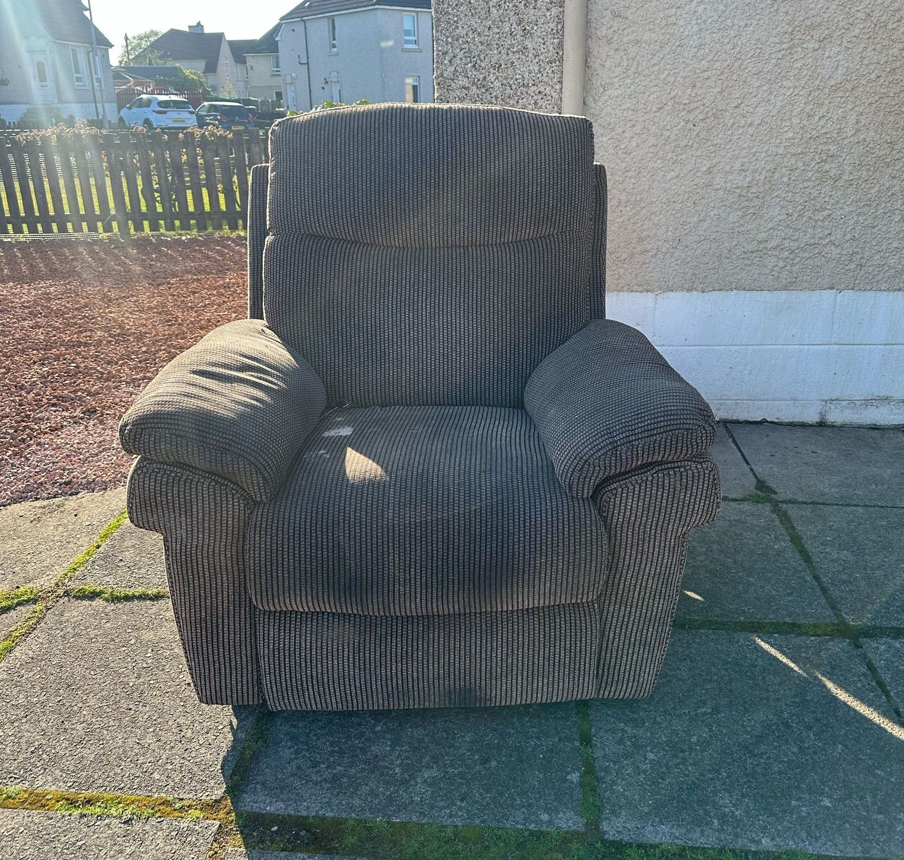
105:         </div>
106:         <div class="pricing-copy">
107:           <p class="eyebrow">Pricing image</p>
108:           <h2>Single Item Removal Price</h2>
109:           <p>When you have only one item to remove, Junk Titanic prices are based on the size. For example, a single wardrobe would cost more than a microwave. If you have more than 1 item, your price is based on truck volume.</p>
110:           <ul class="check-list">
111:             <li>Small appliances (microwave, toaster oven, etc.)</li>
112:             <li>Computer / computer monitor</li>
113:             <li>Any size mattress (single, double or king-size)</li>
114:             <li>Any appliance (washing machine, dryer, BBQ grill, etc.)</li>
115:             <li>Any furniture (sofa, bed frame, dining table, sofa bed, etc.)</li>
116:             <li>Any type of TV</li>
117:             <li>Exercise equipment (treadmill, elliptical trainers, trampoline, etc.)</li>
118:           </ul>
119:         </div>
120:       </div>
121:     </section>
122: 
123:     <section class="section">
124:       <div class="container">
125:         <header class="section-head">
126:           <h2>Single Item Removal</h2>
127:           <p>For multiple items, we price by volume. It’s based on how much space your junk takes up in the truck.</p>
128:         </header>
129: 
130:         <div class="pricing-panel">
131:           <div>
132:             <p>For multiple items? We price by volume. It’s based on how much space your junk takes up in the truck. We have a minimum charge for very small loads; from there, prices go from 1/8th of a truck up to a full truckload. We can give you an exact price when we see the items on site.</p>
133:             <p>Our trucks hold roughly two tons of junk, which is the same as:</p>
134:             <ul class="check-list compact">
135:               <li>Twice 8 cubic yards — equivalent to 2 standard domestic skips</li>
136:               <li>Or, four full-sized three-seater sofas</li>
137:             </ul>
138:           </div>
139:           <div class="mini-badge-box">
140:             <span class="mini-badge">Volume pricing</span>
141:             <strong>Upfront. Transparent. No surprises.</strong>
142:           </div>
143:         </div>
144: 
145:         <div class="volume-grid">
146:           <div class="volume-card">
147:             <div class="volume-visual" aria-label="1/8 truck load">
148:               <div class="media-ph small volume-ph"><span>1/8</span></div>
149:             </div>
150:             <h3>1/8 truck load</h3>
151:             <p class="price-from">from <span class="price-amount">£45</span></p>
152:             <p class="price-items">A few small items or one bulky item</p>
153:           </div>
154:           <div class="volume-card">
155:             <div class="volume-visual" aria-label="1/4 truck load">
156:               <div class="media-ph small volume-ph"><span>1/4</span></div>
157:             </div>
158:             <h3>1/4 truck load</h3>
159:             <p class="price-from">from <span class="price-amount">£80</span></p>
160:             <p class="price-items">A small room clear-out</p>
161:           </div>
162:           <div class="volume-card">
163:             <div class="volume-visual" aria-label="1/2 truck load">
164:               <div class="media-ph small volume-ph"><span>1/2</span></div>
165:             </div>
166:             <h3>1/2 truck load</h3>
167:             <p class="price-from">from <span class="price-amount">£135</span></p>
168:             <p class="price-items">Garage, shed or partial house clearance</p>
169:           </div>
170:           <div class="volume-card">
171:             <div class="volume-visual" aria-label="Full truck load">
172:               <div class="media-ph small volume-ph"><span>Full</span></div>
173:             </div>
174:             <h3>Full truck load</h3>
175:             <p class="price-from">from <span class="price-amount">£220</span></p>
176:             <p class="price-items">Full property or large commercial clear-outs</p>
177:           </div>
178:         </div>
179: 
180:         <p class="center-note">Need a more exact figure? <a href="https://wa.me/447825646222" target="_blank" rel="noopener">Send a photo</a> and we’ll confirm the right price.</p>
181:       </div>
182:     </section>
183: 
184:     <section class="section section-alt">
185:       <div class="container info-grid">
186:         <div class="info-card">
187:           <p class="eyebrow">Who We Are</p>
188:           <h3>Junk Titanic</h3>
189:           <p>Fast, eco-friendly rubbish removal for homes, offices, and gardens. Upfront pricing, same-day service, and responsible disposal.</p>
190:         </div>
191:         <div class="info-card">
192:           <p class="eyebrow">What We Do</p>
193:           <ul class="services-list">
194:             <li>Rubbish Removal</li>
195:             <li>Waste Collection</li>
196:             <li>House Clearance</li>
197:             <li>Junk Collection</li>
198:             <li>Garage Clearance</li>
199:             <li>Shed Clearance &amp; Demolition</li>
200:             <li>Trade Waste Removal</li>
201:             <li>Garden Waste Disposal</li>
202:             <li>Office Clearance</li>
203:             <li>Builders Waste Removal</li>
204:             <li>Renovation Debris Collection</li>
205:           </ul>
206:         </div>
207:       </div>
208:     </section>
209: 
210:     <section class="cta-band">
211:       <div class="container cta-band-inner">
212:         <div>
213:           <h2>Get your exact price</h2>
214:           <p>Send a photo — we'll reply with an all-inclusive quote.</p>
215:         </div>
216:         <div class="cta-row">
217:           <a class="btn btn-wa btn-lg" href="https://wa.me/447825646222" target="_blank" rel="noopener">📷 WhatsApp 07825 646222</a>
218:           <a class="btn btn-primary btn-lg" href="tel:07825646222">📞 Call now</a>
219:         </div>
220:       </div>
221:     </section>
222: 
223:   </main>
224: 
225:   <footer class="site-footer">
226:     <div class="container footer-grid">
227:       <div>
228:         <h3>Junk Titanic</h3>
229:         <p>Fast, eco-friendly rubbish removal for homes, offices and gardens. Upfront pricing, same-day service, responsible disposal.</p>
230:         <p class="footer-badge">SEPA Registered · Fully Insured</p>
231:       </div>
232:       <div>
233:         <h4>Services</h4>
234:         <ul>
235:           <li><a href="service.html">Rubbish Removal</a></li>
236:           <li><a href="service.html">House Clearance</a></li>
237:           <li><a href="service.html">Commercial Waste</a></li>
238:           <li><a href="service.html">Office Clearance</a></li>
239:           <li><a href="service.html">Builders Waste</a></li>
240:           <li><a href="service.html">What We Take</a></li>
241:         </ul>
242:       </div>
243:       <div>
244:         <h4>Areas</h4>
245:         <ul>
246:           <li><a href="location.html">Glasgow</a></li>
247:           <li><a href="location.html">Edinburgh</a></li>
248:           <li><a href="location.html">Stirling</a></li>
249:           <li><a href="location.html">Livingston</a></li>
250:           <li><a href="location.html">Hamilton</a></li>
251:           <li><a href="location.html">Dunfermline</a></li>
252:         </ul>
253:       </div>
254:       <div>
255:         <h4>Contact</h4>
256:         <ul class="contact-list">
257:           <li><a href="tel:07825646222">07825 646222</a></li>
258:           <li><a href="https://wa.me/447825646222" target="_blank" rel="noopener">WhatsApp us</a></li>
259:           <li><a href="mailto:info@junktitanic.co.uk">info@junktitanic.co.uk</a></li>
260:         </ul>
261:         <p class="footer-addr">
262:           Junk Titanic<br />
263:           589 Lawmoor Street<br />
264:           Glasgow, G5 0TT
265:         </p>
266:       </div>
267:     </div>
268:     <div class="container footer-bottom">
269:       <p>© 2026 Junk Titanic. All rights reserved.</p>
270:       <ul>
271:         <li><a href="index.html">Terms</a></li>
272:         <li><a href="contact.html">Privacy</a></li>
273:       </ul>
274:     </div>
275:   </footer>
276: 
277:   <div class="call-bar" aria-label="Quick contact">
278:     <a class="call-bar-call" href="tel:07825646222">📞 Call</a>
279:     <a class="call-bar-wa" href="https://wa.me/447825646222" target="_blank" rel="noopener">📷 WhatsApp</a>
280:   </div>
281: 
282:   <script>
283:     const toggle = document.querySelector('.nav-toggle');
284:     const mobileNav = document.getElementById('mobile-nav');
285:     if (toggle && mobileNav) {
286:       toggle.addEventListener('click', () => {
287:         const open = toggle.getAttribute('aria-expanded') === 'true';
288:         toggle.setAttribute('aria-expanded', String(!open));
289:         mobileNav.hidden = open;
290:       });
291:     }
292:   </script>
293: </body>
294: </html>

(End of file - total 294 lines)
</content>
```

---

## Assistant (Build · Big Pickle · 5.0s)

**Tool: read**

**Input:**
```json
{
  "filePath": "/home/joe/Desktop/projects/junktitan/junkdes/styles.css"
}
```

**Output:**
```
<path>/home/joe/Desktop/projects/junktitan/junkdes/styles.css</path>
<type>file</type>
<content>
1: /* =====================================================
2:    Junk Titanic — base styles
3:    ===================================================== */
4: 
5: :root {
6:   --green: #0B3D2E;
7:   --green-light: #13543f;
8:   --amber: #F5A623;
9:   --amber-dark: #d98e13;
10:   --wa: #25D366;
11:   --wa-dark: #1eaa52;
12:   --ink: #1A1A1A;
13:   --muted: #5a5a5a;
14:   --paper: #FAFAF7;
15:   --line: #e6e6e0;
16:   --white: #ffffff;
17:   --radius: 12px;
18:   --radius-lg: 20px;
19:   --shadow: 0 4px 20px rgba(0,0,0,.06);
20:   --shadow-lg: 0 12px 40px rgba(0,0,0,.10);
21:   --container: 1180px;
22:   --font: 'Inter', -apple-system, BlinkMacSystemFont, 'Segoe UI', Roboto, Helvetica, Arial, sans-serif;
23: }
24: 
25: * { box-sizing: border-box; }
26: 
27: html { scroll-behavior: smooth; }
28: 
29: body {
30:   margin: 0;
31:   font-family: var(--font);
32:   font-size: 16px;
33:   line-height: 1.6;
34:   color: var(--ink);
35:   background: var(--paper);
36:   -webkit-font-smoothing: antialiased;
37: }
38: 
39: img, video { max-width: 100%; height: auto; display: block; }
40: .logo img {
41:   display: block;
42:   width: 170px;
43:   height: auto;
44:   max-width: 100%;
45: }
46: 
47: .hero-media {
48:   display: flex;
49:   justify-content: flex-end;
50: }
51: 
52: .hero-visual {
53:   position: relative;
54:   width: min(100%, 520px);
55:   min-height: 430px;
56:   border-radius: 28px;
57:   overflow: hidden;
58:   box-shadow: 0 26px 70px rgba(11, 61, 46, 0.28);
59:   border: 1px solid rgba(255,255,255,0.18);
60:   background: #123f34;
61: }
62: 
63: .hero-visual img {
64:   width: 100%;
65:   height: 100%;
66:   min-height: 430px;
67:   object-fit: cover;
68:   display: block;
69: }
70: 
71: .hero-badge {
72:   position: absolute;
73:   left: 20px;
74:   right: 20px;
75:   bottom: 20px;
76:   display: flex;
77:   flex-direction: column;
78:   gap: .15rem;
79:   background: rgba(10, 42, 32, 0.72);
80:   border: 1px solid rgba(255,255,255,0.15);
81:   backdrop-filter: blur(8px);
82:   color: #fff;
83:   border-radius: 16px;
84:   padding: .9rem 1rem;
85:   max-width: 240px;
86: }
87: 
88: .hero-badge strong {
89:   font-size: .86rem;
90:   letter-spacing: .12em;
91:   text-transform: uppercase;
92:   color: var(--amber);
93: }
94: 
95: .hero-badge span {
96:   font-size: .9rem;
97:   line-height: 1.4;
98:   color: rgba(255,255,255,0.82);
99: }
100: .logo img {
101:   display: block;
102:   width: 170px;
103:   height: auto;
104:   max-width: 100%;
105: }
106: 
107: .hero-media {
108:   display: flex;
109:   justify-content: flex-end;
110: }
111: 
112: .hero-visual {
113:   position: relative;
114:   width: min(100%, 520px);
115:   min-height: 430px;
116:   border-radius: 28px;
117:   overflow: hidden;
118:   box-shadow: 0 26px 70px rgba(11, 61, 46, 0.28);
119:   border: 1px solid rgba(255,255,255,0.18);
120:   background: #123f34;
121: }
122: 
123: .hero-visual img {
124:   width: 100%;
125:   height: 100%;
126:   min-height: 430px;
127:   object-fit: cover;
128:   display: block;
129: }
130: 
131: .hero-badge {
132:   position: absolute;
133:   left: 20px;
134:   right: 20px;
135:   bottom: 20px;
136:   display: flex;
137:   flex-direction: column;
138:   gap: .15rem;
139:   background: rgba(10, 42, 32, 0.72);
140:   border: 1px solid rgba(255,255,255,0.15);
141:   backdrop-filter: blur(8px);
142:   color: #fff;
143:   border-radius: 16px;
144:   padding: .9rem 1rem;
145:   max-width: 240px;
146: }
147: 
148: .hero-badge strong {
149:   font-size: .86rem;
150:   letter-spacing: .12em;
151:   text-transform: uppercase;
152:   color: var(--amber);
153: }
154: 
155: .hero-badge span {
156:   font-size: .9rem;
157:   line-height: 1.4;
158:   color: rgba(255,255,255,0.82);
159: }
160: 
161: a { color: var(--green); }
162: a:hover { color: var(--amber-dark); }
163: 
164: h1, h2, h3, h4 { line-height: 1.2; margin: 0 0 .5em; font-weight: 700; letter-spacing: -0.02em; }
165: h1 { font-size: clamp(2rem, 4.5vw, 3.2rem); }
166: h2 { font-size: clamp(1.5rem, 3vw, 2.2rem); }
167: h3 { font-size: 1.15rem; }
168: 
169: p { margin: 0 0 1em; }
170: 
171: .container {
172:   width: 100%;
173:   max-width: var(--container);
174:   margin: 0 auto;
175:   padding: 0 20px;
176: }
177: .container.narrow { max-width: 780px; }
178: 
179: /* =====================================================
180:    Buttons
181:    ===================================================== */
182: .btn {
183:   display: inline-flex;
184:   align-items: center;
185:   justify-content: center;
186:   gap: .5rem;
187:   padding: .7rem 1.2rem;
188:   border-radius: 999px;
189:   font-weight: 600;
190:   font-size: .95rem;
191:   text-decoration: none;
192:   transition: transform .15s ease, background .15s ease, box-shadow .15s ease;
193:   white-space: nowrap;
194: }
195: .btn:hover { transform: translateY(-1px); }
196: .btn:focus-visible { outline: 3px solid var(--amber); outline-offset: 2px; }
197: 
198: .btn-primary { background: var(--amber); color: var(--ink); }
199: .btn-primary:hover { background: var(--amber-dark); color: var(--ink); }
200: 
201: .btn-wa { background: var(--wa); color: #fff; }
202: .btn-wa:hover { background: var(--wa-dark); color: #fff; }
203: 
204: .btn-ghost {
205:   background: rgba(11,61,46,.04);
206:   color: var(--green);
207:   border: 1px solid rgba(11,61,46,.15);
208:   box-shadow: 0 10px 22px rgba(11,61,46,.07);
209: }
210: .btn-ghost:hover {
211:   background: var(--green);
212:   color: #fff;
213:   border-color: var(--green);
214: }
215: 
216: .btn-lg { padding: .95rem 1.6rem; font-size: 1.05rem; }
217: 
218: /* =====================================================
219:    Header
220:    ===================================================== */
221: .site-header {
222:   position: sticky;
223:   top: 0;
224:   z-index: 50;
225:   background: linear-gradient(180deg, rgba(250,250,247,0.98), rgba(250,250,247,0.92));
226:   backdrop-filter: blur(18px) saturate(180%);
227:   -webkit-backdrop-filter: blur(18px) saturate(180%);
228:   border-bottom: 1px solid rgba(11, 61, 46, 0.08);
229:   box-shadow: 0 18px 36px rgba(11, 61, 46, 0.06);
230: }
231: .site-header::before {
232:   content: "";
233:   position: absolute;
234:   inset: 0 auto auto 0;
235:   width: 100%;
236:   height: 1px;
237:   background: linear-gradient(90deg, rgba(245,166,35,0), rgba(245,166,35,0.7), rgba(245,166,35,0));
238:   pointer-events: none;
239: }
240: .header-inner {
241:   position: relative;
242:   display: flex;
243:   align-items: center;
244:   justify-content: space-between;
245:   gap: 1.25rem;
246:   padding-top: 16px;
247:   padding-bottom: 16px;
248: }
249: 
250: .logo {
251:   display: flex;
252:   align-items: center;
253:   text-decoration: none;
254:   color: var(--green);
255:   font-weight: 800;
256:   font-size: 1.15rem;
257:   letter-spacing: -.02em;
258:   transition: transform .15s ease;
259: }
260: .logo:hover { transform: translateY(-1px); }
261: .logo img {
262:   display: block;
263:   width: 185px;
264:   height: auto;
265:   max-width: 100%;
266:   filter: drop-shadow(0 10px 18px rgba(11,61,46,.12));
267: }
268: 
269: .main-nav ul {
270:   display: flex;
271:   align-items: center;
272:   justify-content: center;
273:   gap: .35rem;
274:   list-style: none;
275:   margin: 0;
276:   padding: .38rem;
277:   background: linear-gradient(180deg, rgba(11,61,46,.03), rgba(11,61,46,.015));
278:   border: 1px solid rgba(11,61,46,.07);
279:   border-radius: 999px;
280:   box-shadow: inset 0 1px 0 rgba(255,255,255,.85);
281: }
282: .main-nav a {
283:   display: inline-flex;
284:   align-items: center;
285:   justify-content: center;
286:   padding: .72rem .96rem;
287:   border-radius: 999px;
288:   text-decoration: none;
289:   color: var(--ink);
290:   font-weight: 700;
291:   font-size: .88rem;
292:   letter-spacing: -.01em;
293:   transition: background .15s ease, color .15s ease, transform .15s ease, box-shadow .15s ease;
294: }
295: .main-nav a:hover,
296: .main-nav a:focus-visible {
297:   background: rgba(255,255,255,.92);
298:   color: var(--green);
299:   transform: translateY(-1px);
300:   box-shadow: 0 8px 18px rgba(11,61,46,.08);
301: }
302: 
303: .header-actions {
304:   display: flex;
305:   align-items: center;
306:   gap: .7rem;
307: }
308: .header-actions .btn {
309:   box-shadow: 0 8px 18px rgba(11,61,46,.08);
310: }
311: .header-actions .btn-ghost {
312:   border-color: rgba(11,61,46,.16);
313:   background: rgba(255,255,255,.72);
314:   color: var(--green);
315:   font-weight: 700;
316: }
317: .header-actions .btn-ghost:hover {
318:   background: var(--green);
319:   color: #fff;
320:   border-color: var(--green);
321: }
322: .header-actions .btn-wa {
323:   background: linear-gradient(180deg, var(--wa), var(--wa-dark));
324:   color: #fff;
325:   font-weight: 700;
326:   box-shadow: 0 12px 24px rgba(37, 211, 102, 0.2);
327: }
328: 
329: .nav-toggle {
330:   display: none;
331:   background: rgba(11,61,46,.04);
332:   border: 1px solid var(--line);
333:   border-radius: 12px;
334:   padding: .5rem .75rem;
335:   font-size: 1.25rem;
336:   cursor: pointer;
337:   color: var(--green);
338:   transition: background .15s ease, transform .15s ease;
339: }
340: .nav-toggle:hover {
341:   background: rgba(11,61,46,.06);
342:   transform: translateY(-1px);
343: }
344: 
345: .mobile-nav {
346:   border-top: 1px solid var(--line);
347:   background: rgba(255,255,255,.97);
348:   padding: 1rem 20px;
349: }
350: .mobile-nav ul { list-style: none; margin: 0; padding: 0; }
351: .mobile-nav li { border-bottom: 1px solid var(--line); }
352: .mobile-nav a {
353:   display: block;
354:   padding: .85rem 0;
355:   text-decoration: none;
356:   color: var(--ink);
357:   font-weight: 700;
358: }
359: 
360: @media (max-width: 1020px) {
361:   .main-nav { display: none; }
362:   .nav-toggle { display: block; }
363:   .header-actions .btn-ghost { display: none; }
364: }
365: 
366: /* =====================================================
367:    Hero
368:    ===================================================== */
369: .hero {
370:   position: relative;
371:   background: linear-gradient(135deg, #0B3D2E 0%, #113d33 32%, #13543f 100%);
372:   color: #fff;
373:   padding: clamp(3rem, 8vw, 6rem) 0;
374:   overflow: hidden;
375: }
376: .hero::before {
377:   content: "";
378:   position: absolute;
379:   inset: 0;
380:   background: radial-gradient(circle at top right, rgba(245,166,35,0.18), transparent 35%),
381:               linear-gradient(90deg, rgba(255,255,255,0.02), rgba(255,255,255,0));
382:   pointer-events: none;
383: }
384: .hero > .container {
385:   position: relative;
386:   z-index: 1;
387: }
388: .hero {
389:   background: linear-gradient(180deg, #0B3D2E 0%, #13543f 100%);
390:   color: #fff;
391:   padding: clamp(3rem, 8vw, 6rem) 0;
392: }
393: .hero-grid {
394:   display: grid;
395:   grid-template-columns: 1.15fr .85fr;
396:   gap: 3rem;
397:   align-items: center;
398: }
399: .eyebrow {
400:   text-transform: uppercase;
401:   letter-spacing: .12em;
402:   font-size: .78rem;
403:   font-weight: 700;
404:   color: var(--amber);
405:   margin-bottom: 1rem;
406: }
407: .hero h1 { color: #fff; margin-bottom: .8rem; }
408: .lede {
409:   font-size: clamp(1rem, 1.6vw, 1.15rem);
410:   color: rgba(255,255,255,.85);
411:   margin-bottom: 1.8rem;
412:   max-width: 56ch;
413: }
414: .hero .cta-row {
415:   display: flex;
416:   flex-wrap: wrap;
417:   gap: .9rem;
418:   margin-bottom: 1.8rem;
419: }
420: 
421: .trust-strip {
422:   display: flex;
423:   flex-wrap: wrap;
424:   gap: .5rem .9rem;
425:   list-style: none;
426:   padding: 0; margin: 0;
427:   font-size: .85rem;
428:   color: rgba(255,255,255,.8);
429: }
430: .trust-strip li {
431:   display: flex;
432:   align-items: center;
433:   gap: .4rem;
434: }
435: .trust-strip li::before {
436:   content: "";
437:   width: 6px; height: 6px;
438:   border-radius: 50%;
439:   background: var(--amber);
440: }
441: 
442: .media-ph {
443:   background: repeating-linear-gradient(45deg, #1a4a3a, #1a4a3a 12px, #175040 12px, #175040 24px);
444:   border: 2px dashed rgba(255,255,255,.35);
445:   border-radius: var(--radius-lg);
446:   display: grid;
447:   place-items: center;
448:   color: rgba(255,255,255,.7);
449:   font-size: .85rem;
450:   text-align: center;
451:   padding: 1rem;
452:   min-height: 360px;
453: }
454: .media-frame,
455: .feature-image {
456:   position: relative;
457:   width: 100%;
458:   overflow: hidden;
459:   border-radius: 24px;
460:   background: #ebefe9;
461:   border: 1px solid rgba(11,61,46,0.08);
462:   box-shadow: 0 24px 54px rgba(11,61,46,0.10);
463: }
464: .media-frame img,
465: .feature-image img {
466:   display: block;
467:   width: 100%;
468:   height: 100%;
469:   object-fit: cover;
470: }
471: .media-frame {
472:   min-height: 320px;
473: }
474: .feature-image {
475:   min-height: 260px;
476:   margin: 1.8rem 0;
477: }
478: .media-frame img { min-height: 320px; }
479: .feature-image img { min-height: 260px; }
480: .media-ph.small { min-height: 56px; width: 56px; border-radius: 12px; font-size: .65rem; padding: 0; }
481: .media-ph.wide { min-height: 320px; }
482: 
483: @media (max-width: 900px) {
484:   .hero-grid { grid-template-columns: 1fr; gap: 2rem; }
485:   .hero-media { order: -1; }
486:   .hero-visual, .hero-visual img { min-height: 260px; }
487:   .media-ph { min-height: 220px; }
488: }
489: 
490: /* =====================================================
491:    Sections
492:    ===================================================== */
493: .section { padding: clamp(3rem, 7vw, 5.5rem) 0; }
494: .section-alt { background: var(--white); }
495: 
496: .section-head { text-align: center; max-width: 720px; margin: 0 auto 3rem; }
497: .section-head p { color: var(--muted); font-size: 1.05rem; }
498: 
499: /* Steps */
500: .steps {
501:   display: grid;
502:   grid-template-columns: repeat(3, 1fr);
503:   gap: 1.5rem;
504:   list-style: none;
505:   padding: 0; margin: 0;
506:   counter-reset: step;
507: }
508: .steps li {
509:   background: linear-gradient(180deg, #fff, #f8f8f4);
510:   border: 1px solid var(--line);
511:   border-radius: var(--radius-lg);
512:   padding: 2rem 1.6rem;
513:   position: relative;
514:   box-shadow: 0 14px 28px rgba(11,61,46,.05);
515: }
516: .step-num {
517:   display: inline-grid;
518:   place-items: center;
519:   width: 44px; height: 44px;
520:   border-radius: 50%;
521:   background: var(--amber);
522:   color: var(--ink);
523:   font-weight: 800;
524:   margin-bottom: 1rem;
525: }
526: .steps h3 { margin-bottom: .4rem; }
527: .steps p { color: var(--muted); margin: 0; font-size: .95rem; }
528: 
529: @media (max-width: 780px) {
530:   .steps { grid-template-columns: 1fr; }
531: }
532: 
533: /* Cards */
534: .card-thumb {
535:   overflow: hidden;
536:   border-radius: 16px;
537:   margin-bottom: .8rem;
538:   border: 1px solid var(--line);
539:   background: #eef2ee;
540: }
541: 
542: .card-thumb img {
543:   width: 100%;
544:   height: 180px;
545:   object-fit: cover;
546:   display: block;
547:   transition: transform .25s ease;
548: }
549: 
550: .card:hover .card-thumb img {
551:   transform: scale(1.06);
552: }
553: 
554: .cards {
555:   display: grid;
556:   grid-template-columns: repeat(auto-fit, minmax(260px, 1fr));
557:   gap: 1.25rem;
558: }
559: .card {
560:   display: flex;
561:   flex-direction: column;
562:   gap: .5rem;
563:   background: linear-gradient(180deg, #fff, #f7f7f3);
564:   border: 1px solid var(--line);
565:   border-radius: var(--radius-lg);
566:   padding: 1.6rem;
567:   text-decoration: none;
568:   color: var(--ink);
569:   transition: transform .15s ease, box-shadow .15s ease, border-color .15s ease;
570: }
571: .card:hover {
572:   transform: translateY(-4px);
573:   box-shadow: 0 18px 38px rgba(11,61,46,.10);
574:   border-color: rgba(245,166,35,.75);
575: }
576: .card h3 { margin: .4rem 0 .2rem; }
577: .card p { color: var(--muted); font-size: .95rem; margin: 0 0 .6rem; }
578: .card-link { color: var(--green); font-weight: 700; font-size: .9rem; margin-top: auto; }
579: 
580: /* Pillars */
581: .pillars {
582:   display: grid;
583:   grid-template-columns: repeat(auto-fit, minmax(240px, 1fr));
584:   gap: 1.5rem;
585: }
586: .pillar {
587:   padding: 1.6rem;
588:   background: var(--white);
589:   border-radius: var(--radius-lg);
590:   border-top: 4px solid var(--amber);
591:   box-shadow: var(--shadow);
592: }
593: .pillar h3 { margin-bottom: .4rem; }
594: .pillar p { color: var(--muted); margin: 0; font-size: .95rem; }
595: 
596: /* Two column (What we take) */
597: .two-col {
598:   display: grid;
599:   grid-template-columns: 1fr 1fr;
600:   gap: 2rem;
601:   max-width: 920px;
602:   margin: 0 auto;
603: }
604: @media (max-width: 700px) { .two-col { grid-template-columns: 1fr; } }
605: 
606: .list-yes, .list-no {
607:   padding: .4rem .9rem;
608:   border-radius: 999px;
609:   display: inline-block;
610:   font-size: .9rem;
611:   margin-bottom: 1rem;
612: }
613: .list-yes { background: #e6f5ee; color: #0B6b45; }
614: .list-no { background: #fde8e6; color: #a02a1e; }
615: 
616: .check-list, .x-list {
617:   list-style: none;
618:   padding: 0;
619:   margin: 0;
620: }
621: .check-list li, .x-list li {
622:   padding: .55rem 0 .55rem 1.8rem;
623:   border-bottom: 1px solid var(--line);
624:   position: relative;
625: }
626: .check-list li::before {
627:   content: "✓";
628:   position: absolute;
629:   left: 0; top: .55rem;
630:   color: #0B6b45;
631:   font-weight: 800;
632: }
633: .x-list li::before {
634:   content: "✗";
635:   position: absolute;
636:   left: 0; top: .55rem;
637:   color: #a02a1e;
638:   font-weight: 800;
639: }
640: .note {
641:   margin-top: 1rem;
642:   font-size: .9rem;
643:   color: var(--muted);
644:   font-style: italic;
645: }
646: 
647: /* Areas */
648: .areas-grid {
649:   display: grid;
650:   grid-template-columns: repeat(3, 1fr);
651:   gap: 1.5rem;
652:   margin-bottom: 2rem;
653: }
654: .areas-grid > div {
655:   background: linear-gradient(180deg, #fff, #f8f8f5);
656:   padding: 1.5rem;
657:   border-radius: var(--radius-lg);
658:   border: 1px solid var(--line);
659:   box-shadow: 0 12px 30px rgba(11,61,46,.04);
660: }
661: .areas-grid h3 { font-size: 1.05rem; color: var(--green); }
662: .areas-grid p { color: var(--muted); font-size: .92rem; margin: 0; }
663: @media (max-width: 780px) { .areas-grid { grid-template-columns: 1fr; } }
664: 
665: /* Reviews */
666: .reviews {
667:   display: grid;
668:   grid-template-columns: repeat(auto-fit, minmax(260px, 1fr));
669:   gap: 1.25rem;
670: }
671: .review {
672:   margin: 0;
673:   padding: 1.6rem;
674:   background: linear-gradient(180deg, #fff, #f7f7f4);
675:   border-radius: var(--radius-lg);
676:   border-left: 4px solid var(--amber);
677:   box-shadow: 0 14px 26px rgba(11,61,46,.05);
678: }
679: .review p { font-style: italic; margin-bottom: .8rem; }
680: .review cite { font-size: .85rem; color: var(--muted); font-style: normal; font-weight: 600; }
681: 
682: /* FAQ */
683: .faq details {
684:   background: linear-gradient(180deg, #fff, #fafaf8);
685:   border: 1px solid var(--line);
686:   border-radius: var(--radius);
687:   padding: 0;
688:   margin-bottom: .75rem;
689:   overflow: hidden;
690:   box-shadow: 0 12px 22px rgba(11,61,46,.03);
691: }
692: .faq summary {
693:   cursor: pointer;
694:   padding: 1rem 1.25rem;
695:   font-weight: 600;
696:   list-style: none;
697:   position: relative;
698:   padding-right: 3rem;
699: }
700: .faq summary::-webkit-details-marker { display: none; }
701: .faq summary::after {
702:   content: "+";
703:   position: absolute;
704:   right: 1.25rem;
705:   top: 50%;
706:   transform: translateY(-50%);
707:   font-size: 1.4rem;
708:   color: var(--amber-dark);
709:   transition: transform .2s;
710: }
711: .faq details[open] summary::after { content: "−"; }
712: .faq details[open] summary { border-bottom: 1px solid var(--line); }
713: .faq details p { padding: 1rem 1.25rem; margin: 0; color: var(--muted); }
714: 
715: /* CTA band */
716: .cta-band {
717:   background: linear-gradient(135deg, #0B3D2E 0%, #143f32 100%);
718:   color: #fff;
719:   padding: clamp(2.5rem, 6vw, 4rem) 0;
720:   box-shadow: inset 0 1px 0 rgba(255,255,255,.08);
721: }
722: .cta-band-inner {
723:   display: flex;
724:   align-items: center;
725:   justify-content: space-between;
726:   gap: 2rem;
727:   flex-wrap: wrap;
728: }
729: .cta-band h2 { color: #fff; margin-bottom: .3rem; }
730: .cta-band p { color: rgba(255,255,255,.85); margin: 0; }
731: 
732: /* =====================================================
733:    Footer
734:    ===================================================== */
735: .site-footer {
736:   background: linear-gradient(180deg, #0a2a20 0%, #0d3228 100%);
737:   color: rgba(255,255,255,.75);
738:   padding: 3.5rem 0 1.5rem;
739:   font-size: .92rem;
740:   border-top: 1px solid rgba(255,255,255,.06);
741: }
742: .footer-grid {
743:   display: grid;
744:   grid-template-columns: 1.4fr 1fr 1fr 1fr;
745:   gap: 2rem;
746:   margin-bottom: 2.5rem;
747: }
748: .site-footer h3, .site-footer h4 { color: #fff; font-size: 1rem; }
749: .site-footer p { color: rgba(255,255,255,.7); }
750: .site-footer ul { list-style: none; padding: 0; margin: 0; }
751: .site-footer li { padding: .25rem 0; }
752: .site-footer a { color: rgba(255,255,255,.75); text-decoration: none; }
753: .site-footer a:hover { color: var(--amber); }
754: 
755: .footer-badge {
756:   display: inline-block;
757:   margin-top: .6rem;
758:   padding: .35rem .8rem;
759:   background: rgba(245,166,35,.15);
760:   border: 1px solid rgba(245,166,35,.4);
761:   border-radius: 999px;
762:   font-size: .78rem;
763:   color: var(--amber) !important;
764:   font-weight: 600;
765: }
766: 
767: .footer-addr { margin-top: 1rem; font-size: .85rem; line-height: 1.5; }
768: 
769: .footer-bottom {
770:   border-top: 1px solid rgba(255,255,255,.1);
771:   padding-top: 1.5rem;
772:   display: flex;
773:   justify-content: space-between;
774:   align-items: center;
775:   gap: 1rem;
776:   flex-wrap: wrap;
777:   font-size: .82rem;
778: }
779: .footer-bottom p { margin: 0; }
780: .footer-bottom ul { display: flex; gap: 1.2rem; }
781: 
782: @media (max-width: 880px) {
783:   .footer-grid { grid-template-columns: 1fr 1fr; }
784: }
785: @media (max-width: 520px) {
786:   .footer-grid { grid-template-columns: 1fr; }
787: }
788: 
789: /* =====================================================
790:    Mobile sticky call bar
791:    ===================================================== */
792: .call-bar {
793:   display: none;
794:   position: fixed;
795:   bottom: 0; left: 0; right: 0;
796:   z-index: 60;
797:   background: var(--white);
798:   border-top: 1px solid var(--line);
799:   box-shadow: 0 -4px 20px rgba(0,0,0,.08);
800:   padding: .55rem .75rem calc(.55rem + env(safe-area-inset-bottom));
801:   gap: .5rem;
802: }
803: .call-bar a {
804:   flex: 1;
805:   text-align: center;
806:   padding: .85rem .5rem;
807:   border-radius: 10px;
808:   font-weight: 700;
809:   font-size: .95rem;
810:   text-decoration: none;
811: }
812: .call-bar-call { background: var(--green); color: #fff; }
813: .call-bar-wa { background: var(--wa); color: #fff; }
814: 
815: @media (max-width: 880px) {
816:   .call-bar { display: flex; }
817:   body { padding-bottom: 76px; }
818: }
819: 
820: /* =====================================================
821:    Motion / a11y
822:    ===================================================== */
823: @media (prefers-reduced-motion: reduce) {
824:   *, *::before, *::after { animation-duration: .001ms !important; transition-duration: .001ms !important; scroll-behavior: auto !important; }
825:   .btn:hover, .card:hover { transform: none; }
826: }
827: 
828: :focus-visible {
829:   outline: 3px solid var(--amber);
830:   outline-offset: 2px;
831:   border-radius: 4px;
832: }
833: 
834: 
835: 
836: 
837: /* =====================================================
838:    Sub-page heroes
839:    ===================================================== */
840: .hero-sub {
841:   padding: clamp(2rem, 5vw, 3.5rem) 0;
842: }
843: .hero-sub .container { display: flex; }
844: .hero-sub .hero-grid { width: 100%; }
845: .narrow-copy {
846:   max-width: 780px;
847:   margin: 0 auto;
848:   width: 100%;
849: }
850: 
851: .breadcrumb {
852:   font-size: .85rem;
853:   margin-bottom: 1.2rem;
854: }
855: .breadcrumb ol {
856:   list-style: none;
857:   padding: 0; margin: 0;
858:   display: flex;
859:   flex-wrap: wrap;
860:   gap: .4rem;
861:   color: rgba(255,255,255,.65);
862: }
863: .breadcrumb li + li::before {
864:   content: "›";
865:   margin-right: .4rem;
866:   color: rgba(255,255,255,.4);
867: }
868: .breadcrumb a {
869:   color: rgba(255,255,255,.85);
870:   text-decoration: none;
871: }
872: .breadcrumb a:hover { color: var(--amber); }
873: 
874: .hero-sub .lede { max-width: 60ch; }
875: 
876: /* =====================================================
877:    Service layout (main + sidebar)
878:    ===================================================== */
879: .service-layout {
880:   display: grid;
881:   grid-template-columns: minmax(0, 1fr) 340px;
882:   gap: 3rem;
883:   align-items: start;
884: }
885: @media (max-width: 960px) {
886:   .service-layout { grid-template-columns: 1fr; gap: 2rem; }
887: }
888: 
889: .service-main h3 {
890:   margin-top: 1.8rem;
891:   margin-bottom: .6rem;
892:   font-size: 1.15rem;
893:   color: var(--green);
894: }
895: .service-main p { color: #2a2a2a; }
896: .service-main .check-list { margin-bottom: 1rem; }
897: .service-main .media-ph.wide { margin: 1.8rem 0; }
898: 
899: .section-head.left { text-align: left; margin-left: 0; }
900: 
901: /* Sidebar */
902: .service-aside {
903:   position: sticky;
904:   top: 100px;
905:   display: flex;
906:   flex-direction: column;
907:   gap: 1.2rem;
908: }
909: @media (max-width: 960px) {
910:   .service-aside { position: static; }
911: }
912: 
913: .quote-card {
914:   background: var(--white);
915:   border: 1px solid var(--line);
916:   border-radius: var(--radius-lg);
917:   padding: 1.6rem;
918:   box-shadow: var(--shadow);
919: }
920: .quote-card h3 { margin-bottom: .4rem; }
921: .quote-card p { color: var(--muted); font-size: .95rem; }
922: .quote-card .btn-block { width: 100%; margin-top: .6rem; }
923: .quote-card .small-print {
924:   text-align: center;
925:   font-size: .8rem;
926:   color: var(--muted);
927:   margin: .8rem 0 0;
928: }
929: 
930: .btn-block {
931:   display: flex;
932:   width: 100%;
933: }
934: 
935: .aside-block {
936:   background: var(--white);
937:   border: 1px solid var(--line);
938:   border-radius: var(--radius-lg);
939:   padding: 1.4rem;
940: }
941: .aside-block h4 {
942:   font-size: .95rem;
943:   text-transform: uppercase;
944:   letter-spacing: .08em;
945:   color: var(--muted);
946:   margin-bottom: .8rem;
947: }
948: .link-list {
949:   list-style: none;
950:   padding: 0; margin: 0;
951: }
952: .link-list li { padding: .4rem 0; border-bottom: 1px solid var(--line); }
953: .link-list li:last-child { border-bottom: none; }
954: .link-list a {
955:   text-decoration: none;
956:   color: var(--ink);
957:   font-size: .95rem;
958: }
959: .link-list a:hover { color: var(--amber-dark); }
960: 
961: /* =====================================================
962:    Center note
963:    ===================================================== */
964: .center-note {
965:   text-align: center;
966:   margin-top: 2rem;
967:   color: var(--muted);
968:   font-size: .95rem;
969: }
970: .center-note a {
971:   color: var(--green);
972:   font-weight: 600;
973: }
974: 
975: /* =====================================================
976:    Pricing page
977:    ===================================================== */
978: .pricing-overview {
979:   display: grid;
980:   grid-template-columns: 1.3fr 1fr;
981:   gap: 1.5rem;
982:   align-items: stretch;
983: }
984: .info-panel,
985: .stat-panel,
986: .info-card,
987: .pricing-panel {
988:   background: var(--white);
989:   border: 1px solid var(--line);
990:   border-radius: 24px;
991:   padding: 2rem;
992:   box-shadow: var(--shadow);
993: }
994: .info-panel h2 { margin-bottom: .5rem; }
995: .info-panel p { color: var(--muted); }
996: .stat-panel {
997:   display: grid;
998:   grid-template-columns: 1fr;
999:   gap: 1rem;
1000:   background: linear-gradient(180deg, rgba(11,61,46,0.04), rgba(245,166,35,0.04));
1001: }
1002: .stat-box {
1003:   display: flex;
1004:   flex-direction: column;
1005:   justify-content: center;
1006:   padding: 1.1rem 1rem;
1007:   border-radius: 18px;
1008:   background: rgba(255,255,255,0.7);
1009:   border: 1px solid rgba(11,61,46,0.08);
1010: }
1011: .stat-number {
1012:   display: block;
1013:   font-size: clamp(1.4rem, 2vw, 2rem);
1014:   font-weight: 800;
1015:   color: var(--green);
1016:   line-height: 1.1;
1017: }
1018: .stat-label {
1019:   font-size: .82rem;
1020:   color: var(--muted);
1021:   letter-spacing: .04em;
1022:   text-transform: uppercase;
1023: }
1024: 
1025: .pricing-showcase {
1026:   display: grid;
1027:   grid-template-columns: 1.05fr 1.2fr;
1028:   gap: 2rem;
1029:   align-items: center;
1030: }
1031: .pricing-visual {
1032:   overflow: hidden;
1033:   border-radius: 26px;
1034:   border: 1px solid var(--line);
1035:   box-shadow: var(--shadow-lg);
1036:   background: var(--white);
1037: }
1038: .pricing-visual img {
1039:   width: 100%;
1040:   height: 100%;
1041:   min-height: 380px;
1042:   object-fit: cover;
1043:   display: block;
1044: }
1045: .pricing-copy p,
1046: .pricing-copy li { color: var(--muted); }
1047: 
1048: .pricing-panel {
1049:   display: grid;
1050:   grid-template-columns: 1.6fr .9fr;
1051:   gap: 1.5rem;
1052:   align-items: center;
1053:   margin: 1.5rem 0;
1054: }
1055: .mini-badge-box {
1056:   display: flex;
1057:   flex-direction: column;
1058:   align-items: flex-start;
1059:   justify-content: center;
1060:   padding: 1.2rem 1.3rem;
1061:   background: linear-gradient(135deg, rgba(11,61,46,0.96), rgba(19,84,63,0.92));
1062:   color: var(--white);
1063:   border-radius: 20px;
1064:   min-height: 160px;
1065: }
1066: .mini-badge {
1067:   display: inline-block;
1068:   padding: .45rem .75rem;
1069:   border-radius: 999px;
1070:   background: rgba(245,166,35,0.18);
1071:   color: var(--amber);
1072:   font-weight: 700;
1073:   font-size: .7rem;
1074:   letter-spacing: .08em;
1075:   text-transform: uppercase;
1076:   margin-bottom: 1rem;
1077: }
1078: .mini-badge-box strong {
1079:   font-size: 1.3rem;
1080:   line-height: 1.25;
1081: }
1082: 
1083: .info-grid {
1084:   display: grid;
1085:   grid-template-columns: repeat(2, minmax(0, 1fr));
1086:   gap: 1.5rem;
1087: }
1088: .info-card h3 {
1089:   margin-bottom: .5rem;
1090: }
1091: .services-list {
1092:   list-style: none;
1093:   padding: 0;
1094:   margin: 0;
1095:   display: grid;
1096:   grid-template-columns: repeat(2, minmax(0, 1fr));
1097:   gap: .55rem .9rem;
1098:   color: var(--muted);
1099: }
1100: .services-list li {
1101:   position: relative;
1102:   padding-left: 1rem;
1103: }
1104: .services-list li::before {
1105:   content: "•";
1106:   position: absolute;
1107:   left: 0;
1108:   color: var(--amber);
1109:   font-weight: 800;
1110: }
1111: .check-list.compact {
1112:   margin-top: .8rem;
1113: }
1114: @media (max-width: 900px) {
1115:   .pricing-overview,
1116:   .pricing-showcase,
1117:   .pricing-panel,
1118:   .info-grid {
1119:     grid-template-columns: 1fr;
1120:   }
1121: }
1122: 
1123: .price-grid {  display: grid;
1124:   grid-template-columns: repeat(auto-fit, minmax(220px, 1fr));
1125:   gap: 1.2rem;
1126: }
1127: .price-card {
1128:   background: var(--paper);
1129:   border: 1px solid var(--line);
1130:   border-radius: var(--radius-lg);
1131:   padding: 1.5rem;
1132:   text-align: center;
1133: }
1134: .price-card h3 {
1135:   font-size: 1rem;
1136:   margin-bottom: .8rem;
1137: }
1138: .price-from {
1139:   font-size: .85rem;
1140:   color: var(--muted);
1141:   margin-bottom: .3rem;
1142: }
1143: .price-amount {
1144:   display: block;
1145:   font-size: 1.6rem;
1146:   font-weight: 800;
1147:   color: var(--green);
1148:   margin-top: .1rem;
1149: }
1150: .price-items {
1151:   font-size: .85rem;
1152:   color: var(--muted);
1153:   margin: .6rem 0 0;
1154:   line-height: 1.4;
1155: }
1156: 
1157: .volume-grid {
1158:   display: grid;
1159:   grid-template-columns: repeat(auto-fit, minmax(230px, 1fr));
1160:   gap: 1.2rem;
1161:   margin-bottom: 1.5rem;
1162: }
1163: .volume-card {
1164:   background: var(--white);
1165:   border: 1px solid var(--line);
1166:   border-radius: var(--radius-lg);
1167:   padding: 1.5rem;
1168:   text-align: center;
1169:   box-shadow: var(--shadow);
1170: }
1171: .volume-visual {
1172:   display: flex;
1173:   justify-content: center;
1174:   margin-bottom: 1rem;
1175: }
1176: .volume-ph {
1177:   width: 80px !important;
1178:   height: 80px !important;
1179:   border-radius: 50% !important;
1180:   font-size: .85rem !important;
1181:   font-weight: 800;
1182: }
1183: .volume-card h3 { font-size: 1rem; margin-bottom: .4rem; }
1184: .volume-card .price-items { margin-top: .5rem; }
1185: 
1186: /* Small print */
1187: .small-print {
1188:   font-size: .82rem;
1189:   color: var(--muted);
1190:   line-height: 1.5;
1191: }
1192: 
1193: /* =====================================================
1194:    Contact page
1195:    ===================================================== */
1196: .contact-options {
1197:   display: grid;
1198:   grid-template-columns: repeat(auto-fit, minmax(260px, 1fr));
1199:   gap: 1.2rem;
1200: }
1201: .contact-tile {
1202:   display: block;
1203:   padding: 2rem 1.6rem;
1204:   border-radius: var(--radius-lg);
1205:   text-decoration: none;
1206:   color: var(--ink);
1207:   background: var(--white);
1208:   border: 1px solid var(--line);
1209:   box-shadow: var(--shadow);
1210:   transition: transform .15s, box-shadow .15s, border-color .15s;
1211:   text-align: center;
1212: }
1213: .contact-tile:hover {
1214:   transform: translateY(-3px);
1215:   box-shadow: var(--shadow-lg);
1216: }
1217: .contact-tile-wa:hover { border-color: var(--wa); }
1218: .contact-tile-call:hover { border-color: var(--amber); }
1219: .contact-tile-email:hover { border-color: var(--green); }
1220: 
1221: .contact-icon {
1222:   font-size: 2.2rem;
1223:   margin-bottom: .8rem;
1224: }
1225: .contact-tile h3 { margin-bottom: .4rem; }
1226: .contact-tile p {
1227:   color: var(--muted);
1228:   font-size: .95rem;
1229:   margin-bottom: 1rem;
1230: }
1231: .contact-action {
1232:   font-weight: 700;
1233:   color: var(--green);
1234:   font-size: .9rem;
1235: }
1236: .contact-tile-wa .contact-action { color: var(--wa-dark); }
1237: 
1238: /* =====================================================
1239:    Booking form
1240:    ===================================================== */
1241: .booking-form {
1242:   background: var(--white);
1243:   border: 1px solid var(--line);
1244:   border-radius: var(--radius-lg);
1245:   padding: 2rem;
1246:   box-shadow: var(--shadow);
1247: }
1248: .booking-form fieldset {
1249:   border: none;
1250:   padding: 0;
1251:   margin: 0 0 1.8rem;
1252: }
1253: .booking-form fieldset:last-of-type { margin-bottom: 1rem; }
1254: .booking-form legend {
1255:   font-weight: 700;
1256:   font-size: 1.05rem;
1257:   color: var(--green);
1258:   margin-bottom: 1rem;
1259:   padding: 0;
1260: }
1261: 
1262: .field-label {
1263:   display: block;
1264:   font-weight: 600;
1265:   font-size: .9rem;
1266:   margin: .9rem 0 .35rem;
1267:   color: var(--ink);
1268: }
1269: .optional {
1270:   font-weight: 400;
1271:   color: var(--muted);
1272:   font-size: .85rem;
1273: }
1274: .field-help {
1275:   font-size: .82rem;
1276:   color: var(--muted);
1277:   margin: .35rem 0 0;
1278: }
1279: 
1280: .booking-form input[type="text"],
1281: .booking-form input[type="tel"],
1282: .booking-form input[type="email"],
1283: .booking-form input[type="date"],
1284: .booking-form select,
1285: .booking-form textarea {
1286:   width: 100%;
1287:   padding: .8rem 1rem;
1288:   border: 1px solid #d6d6ce;
1289:   border-radius: 10px;
1290:   background: var(--paper);
1291:   font-family: inherit;
1292:   font-size: 1rem;
1293:   color: var(--ink);
1294:   transition: border-color .15s, box-shadow .15s;
1295: }
1296: .booking-form input:focus,
1297: .booking-form select:focus,
1298: .booking-form textarea:focus {
1299:   outline: none;
1300:   border-color: var(--amber);
1301:   box-shadow: 0 0 0 3px rgba(245,166,35,.15);
1302: }
1303: .booking-form textarea { resize: vertical; min-height: 90px; }
1304: .booking-form input[type="file"] {
1305:   font-size: .9rem;
1306:   padding: .5rem 0;
1307: }
1308: 
1309: .two-field-row {
1310:   display: grid;
1311:   grid-template-columns: 1fr 1fr;
1312:   gap: 1rem;
1313: }
1314: @media (max-width: 520px) {
1315:   .two-field-row { grid-template-columns: 1fr; }
1316: }
1317: 
1318: .radio-row {
1319:   display: flex;
1320:   flex-wrap: wrap;
1321:   gap: .6rem;
1322:   margin-top: .4rem;
1323: }
1324: .radio {
1325:   display: flex;
1326:   align-items: center;
1327:   gap: .45rem;
1328:   padding: .6rem 1rem;
1329:   border: 1px solid #d6d6ce;
1330:   border-radius: 999px;
1331:   background: var(--paper);
1332:   cursor: pointer;
1333:   font-size: .92rem;
1334:   transition: border-color .15s, background .15s;
1335: }
1336: .radio:hover { border-color: var(--amber); }
1337: .radio input { accent-color: var(--green); }
1338: .radio:has(input:checked) {
1339:   border-color: var(--amber);
1340:   background: rgba(245,166,35,.08);
1341: }
1342: 
1343: .form-submit {
1344:   display: flex;
1345:   align-items: center;
1346:   gap: 1.2rem;
1347:   flex-wrap: wrap;
1348:   margin-top: 1.6rem;
1349:   padding-top: 1.6rem;
1350:   border-top: 1px solid var(--line);
1351: }
1352: .form-submit .small-print { margin: 0; }
1353: 
1354: /* =====================================================
1355:    Contact details block
1356:    ===================================================== */
1357: .contact-details {
1358:   display: grid;
1359:   grid-template-columns: repeat(auto-fit, minmax(220px, 1fr));
1360:   gap: 2rem;
1361:   margin-bottom: 2rem;
1362: }
1363: .contact-details h3 {
1364:   font-size: 1rem;
1365:   color: var(--green);
1366:   margin-bottom: .8rem;
1367: }
1368: .contact-details ul { list-style: none; padding: 0; margin: 0; }
1369: .contact-details li { padding: .3rem 0; }
1370: .contact-details a { text-decoration: none; color: var(--ink); }
1371: .contact-details a:hover { color: var(--amber-dark); }
1372: .contact-details address {
1373:   font-style: normal;
1374:   color: var(--muted);
1375:   line-height: 1.6;
1376: }
1377: .contact-details p { color: var(--muted); }
1378: 
1379: /* =====================================================
1380:    Misc helpers
1381:    ===================================================== */
1382: .service-main .check-list li strong { color: var(--green); }
1383: 
1384: .pricing-hero {
1385:   padding: 3.25rem 0 2.25rem;
1386:   background: linear-gradient(180deg, rgba(11,61,46,0.04), rgba(250,250,247,0.96));
1387: }
1388: .pricing-hero-inner {
1389:   display: flex;
1390:   align-items: center;
1391:   justify-content: center;
1392: }
1393: .pricing-copy-wrap {
1394:   max-width: 960px;
1395:   text-align: center;
1396: }
1397: .brand-lockup {
1398:   margin: 1rem auto 1.25rem;
1399:   display: flex;
1400:   justify-content: center;
1401: }
1402: .brand-lockup img {
1403:   width: 230px;
1404:   max-width: 100%;
1405:   height: auto;
1406: }
1407: 
1408: .pricing-overview {
1409:   display: grid;
1410:   grid-template-columns: 1.35fr 1fr;
1411:   gap: 1.5rem;
1412:   align-items: stretch;
1413: }
1414: .info-panel,
1415: .stat-panel,
1416: .info-card,
1417: .pricing-panel {
1418:   background: var(--white);
1419:   border: 1px solid var(--line);
1420:   border-radius: 24px;
1421:   padding: 2rem;
1422:   box-shadow: var(--shadow);
1423: }
1424: .info-panel h2 { margin-bottom: .5rem; }
1425: .info-panel p { color: var(--muted); }
1426: .stat-panel {
1427:   display: grid;
1428:   grid-template-columns: 1fr;
1429:   gap: 1rem;
1430:   background: linear-gradient(180deg, rgba(11,61,46,0.04), rgba(245,166,35,0.04));
1431: }
1432: .stat-box {
1433:   display: flex;
1434:   flex-direction: column;
1435:   justify-content: center;
1436:   padding: 1.1rem 1rem;
1437:   border-radius: 18px;
1438:   background: rgba(255,255,255,0.7);
1439:   border: 1px solid rgba(11,61,46,0.08);
1440: }
1441: .stat-number {
1442:   display: block;
1443:   font-size: clamp(1.4rem, 2vw, 2rem);
1444:   font-weight: 800;
1445:   color: var(--green);
1446:   line-height: 1.1;
1447: }
1448: .stat-label {
1449:   font-size: .82rem;
1450:   color: var(--muted);
1451:   letter-spacing: .04em;
1452:   text-transform: uppercase;
1453: }
1454: 
1455: .pricing-showcase {
1456:   display: grid;
1457:   grid-template-columns: 1.05fr 1.2fr;
1458:   gap: 2rem;
1459:   align-items: center;
1460: }
1461: .pricing-visual {
1462:   overflow: hidden;
1463:   border-radius: 26px;
1464:   border: 1px solid var(--line);
1465:   box-shadow: var(--shadow-lg);
1466:   background: var(--white);
1467: }
1468: .pricing-visual img {
1469:   width: 100%;
1470:   height: 100%;
1471:   min-height: 380px;
1472:   object-fit: cover;
1473:   display: block;
1474: }
1475: .pricing-copy p,
1476: .pricing-copy li,
1477: .info-card p,
1478: .info-card li { color: var(--muted); }
1479: 
1480: .pricing-panel {
1481:   display: grid;
1482:   grid-template-columns: 1.6fr .9fr;
1483:   gap: 1.5rem;
1484:   align-items: center;
1485:   margin: 1.5rem 0;
1486: }
1487: .mini-badge-box {
1488:   display: flex;
1489:   flex-direction: column;
1490:   align-items: flex-start;
1491:   justify-content: center;
1492:   padding: 1.2rem 1.3rem;
1493:   background: linear-gradient(135deg, rgba(11,61,46,0.96), rgba(19,84,63,0.92));
1494:   color: var(--white);
1495:   border-radius: 20px;
1496:   min-height: 160px;
1497: }
1498: .mini-badge {
1499:   display: inline-block;
1500:   padding: .45rem .75rem;
1501:   border-radius: 999px;
1502:   background: rgba(245,166,35,0.18);
1503:   color: var(--amber);
1504:   font-weight: 700;
1505:   font-size: .7rem;
1506:   letter-spacing: .08em;
1507:   text-transform: uppercase;
1508:   margin-bottom: 1rem;
1509: }
1510: .mini-badge-box strong {
1511:   font-size: 1.3rem;
1512:   line-height: 1.25;
1513: }
1514: 
1515: .info-grid {
1516:   display: grid;
1517:   grid-template-columns: repeat(2, minmax(0, 1fr));
1518:   gap: 1.5rem;
1519: }
1520: .info-card h3 {
1521:   margin-bottom: .5rem;
1522: }
1523: .services-list {
1524:   list-style: none;
1525:   padding: 0;
1526:   margin: 0;
1527:   display: grid;
1528:   grid-template-columns: repeat(2, minmax(0, 1fr));
1529:   gap: .55rem .9rem;
1530:   color: var(--muted);
1531: }
1532: .services-list li {
1533:   position: relative;
1534:   padding-left: 1rem;
1535: }
1536: .services-list li::before {
1537:   content: "•";
1538:   position: absolute;
1539:   left: 0;
1540:   color: var(--amber);
1541:   font-weight: 800;
1542: }
1543: .check-list.compact {
1544:   margin-top: .8rem;
1545: }
1546: @media (max-width: 900px) {
1547:   .pricing-overview,
1548:   .pricing-showcase,
1549:   .pricing-panel,
1550:   .info-grid {
1551:     grid-template-columns: 1fr;
1552:   }
1553: }

(End of file - total 1553 lines)
</content>
```

**Tool: read**

**Input:**
```json
{
  "filePath": "/home/joe/Desktop/projects/junktitan/junkdes/videos"
}
```

**Output:**
```
<path>/home/joe/Desktop/projects/junktitan/junkdes/videos</path>
<type>directory</type>
<entries>
WhatsApp-Video-2026-08-11-at-6.32.24-PM.mp4

(1 entries)
</entries>
```

**Tool: read**

**Input:**
```json
{
  "filePath": "/home/joe/Desktop/projects/junktitan/junkdes/pricing"
}
```

**Output:**
```
<path>/home/joe/Desktop/projects/junktitan/junkdes/pricing</path>
<type>directory</type>
<entries>
Junk-Tintanic-Pricingvehicle.webp

(1 entries)
</entries>
```

---

## Assistant (Build · Big Pickle · 7.6s)

**Tool: read**

**Input:**
```json
{
  "filePath": "/home/joe/Desktop/projects/junktitan/junkdes/service.html"
}
```

**Output:**
```
<path>/home/joe/Desktop/projects/junktitan/junkdes/service.html</path>
<type>file</type>
<content>
1: <!DOCTYPE html>
2: <html lang="en-GB">
3: <head>
4:   <meta charset="UTF-8" />
5:   <meta name="viewport" content="width=device-width, initial-scale=1" />
6:   <title>Rubbish Removal | Junk Titanic</title>
7:   <meta name="description" content="Professional rubbish removal across Central Scotland. SEPA-registered, fully insured, upfront pricing. Send a photo on WhatsApp for a fast quote." />
8:   <link rel="stylesheet" href="styles.css" />
9: </head>
10: <body>
11: 
12:   <!-- ============ HEADER (same as home) ============ -->
13:   <header class="site-header" role="banner">
14:     <div class="container header-inner">
15:       <a href="index.html" class="logo" aria-label="Junk Titanic home">
16:         
17:       </a>
18:       <nav class="main-nav" aria-label="Primary">
19:         <ul>
20:           <li><a href="service.html">Rubbish Removal</a></li>
21:           <li><a href="service.html">House Clearance</a></li>
22:           <li><a href="service.html">Commercial</a></li>
23:           <li><a href="pricing.html">Pricing</a></li>
24:           <li><a href="service.html">What We Take</a></li>
25:           <li><a href="location.html">Areas</a></li>
26:         </ul>
27:       </nav>
28:       <div class="header-actions">
29:         <a class="btn btn-ghost" href="tel:07825646222">07825 646222</a>
30:         <a class="btn btn-wa" href="https://wa.me/447825646222" target="_blank" rel="noopener">WhatsApp a photo</a>
31:         <button class="nav-toggle" aria-label="Open menu" aria-expanded="false" aria-controls="mobile-nav">☰</button>
32:       </div>
33:     </div>
34:     <nav id="mobile-nav" class="mobile-nav" aria-label="Mobile" hidden>
35:       <ul>
36:         <li><a href="service.html">Rubbish Removal</a></li>
37:         <li><a href="service.html">House Clearance</a></li>
38:         <li><a href="service.html">Commercial Waste</a></li>
39:         <li><a href="pricing.html">Pricing</a></li>
40:         <li><a href="service.html">What We Take</a></li>
41:         <li><a href="location.html">Areas We Cover</a></li>
42:         <li><a href="service.html">FAQs</a></li>
43:         <li><a href="contact.html">Contact</a></li>
44:       </ul>
45:     </nav>
46:   </header>
47: 
48:   <main>
49: 
50:     <!-- ============ HERO (service) ============ -->
51:     <section class="hero hero-sub">
52:       <div class="container hero-grid">
53:         <div class="hero-copy">
54:           <nav class="breadcrumb" aria-label="Breadcrumb">
55:             <ol>
56:               <li><a href="index.html">Home</a></li>
57:               <li><a href="service.html">Services</a></li>
58:               <li aria-current="page">Rubbish Removal</li>
59:             </ol>
60:           </nav>
61:           <p class="eyebrow">SEPA-registered · Fully insured</p>
62:           <h1>Rubbish Removal in Glasgow, Edinburgh &amp; Central Scotland</h1>
63:           <p class="lede">
64:             Fast, eco-friendly rubbish uplift for homes and businesses. We do the lifting,
65:             loading and sweeping — you just point. Upfront, all-inclusive price before we start.
66:           </p>
67:           <div class="cta-row">
68:             <a class="btn btn-wa btn-lg" href="https://wa.me/447825646222?text=Hi%2C%20I%27d%20like%20a%20rubbish%20removal%20quote" target="_blank" rel="noopener">
69:               📷 Send a photo on WhatsApp
70:             </a>
71:             <a class="btn btn-primary btn-lg" href="tel:07825646222">📞 Call 07825 646222</a>
72:           </div>
73:           <ul class="trust-strip" aria-label="Trust signals">
74:             <li>Same-day possible</li>
75:             <li>Upfront pricing</li>
76:             <li>We sweep afterwards</li>
77:           </ul>
78:         </div>
79:         <div class="hero-media">
80:           <!-- MEDIA: hero image — alt="Junk Titanic crew loading household rubbish into a van in Glasgow" -->
81:           <div class="hero-visual" role="img" aria-label="Junk Titanic crew removing rubbish from a home in Glasgow">
82:             
83:             <div class="hero-badge">
84:               <strong>Fast quote</strong>
85:               <span>Photo-first pricing, same-day where possible.</span>
86:             </div>
87:           </div>
88:         </div>
89:       </div>
90:     </section>
91: 
92:     <!-- ============ WHAT'S INCLUDED ============ -->
93:     <section class="section">
94:       <div class="container service-layout">
95:         <article class="service-main">
96:           <header class="section-head left">
97:             <h2>What our rubbish removal service covers</h2>
98:             <p>Household, garden, office and construction waste — cleared in one visit.</p>
99:           </header>
100: 
101:           <p>Whether you're clearing out a few bulky items, emptying a garage, or dealing with the aftermath of a renovation, Junk Titanic provides a full-service rubbish uplift across Glasgow, Edinburgh, Stirling, Livingston, Falkirk, Kilmarnock and the surrounding towns in Scotland's Central Belt.</p>
102: 
103:           <p>Our uniformed crew does all the lifting and loading — from wherever items are located — then sweeps up before leaving. You don't need a skip, a van, or a trip to the tip.</p>
104: 
105:           <h3>Typical items we uplift</h3>
106:           <ul class="check-list">
107:             <li>Sofas, settees, armchairs and sofa beds</li>
108:             <li>Wardrobes, drawers, beds and mattresses</li>
109:             <li>Washing machines, fridges, cookers and dishwashers</li>
110:             <li>TVs, monitors, printers and computer equipment</li>
111:             <li>Garden waste, fence panels, sheds and decking</li>
112:             <li>Kitchen and bathroom rip-outs</li>
113:             <li>General household clutter and bric-a-brac</li>
114:             <li>Office furniture, filing cabinets and confidential paper (secure shredding available)</li>
115:           </ul>
116: 
117:           <h3>Who it's for</h3>
118:           <ul class="check-list">
119:             <li>Homeowners and tenants clearing junk</li>
120:             <li>Landlords and letting agents turning a property around</li>
121:             <li>Estate agents and property managers preparing a sale</li>
122:             <li>Builders and tradespeople needing a skip alternative</li>
123:             <li>Offices, shops and hospitality businesses</li>
124:           </ul>
125: 
126:           <!-- MEDIA: in-body image — alt="Bulky sofa and wardrobe ready for collection in a Glasgow flat" -->
127:           <div class="feature-image" role="img" aria-label="Bulky furniture and white goods ready for collection">
128:             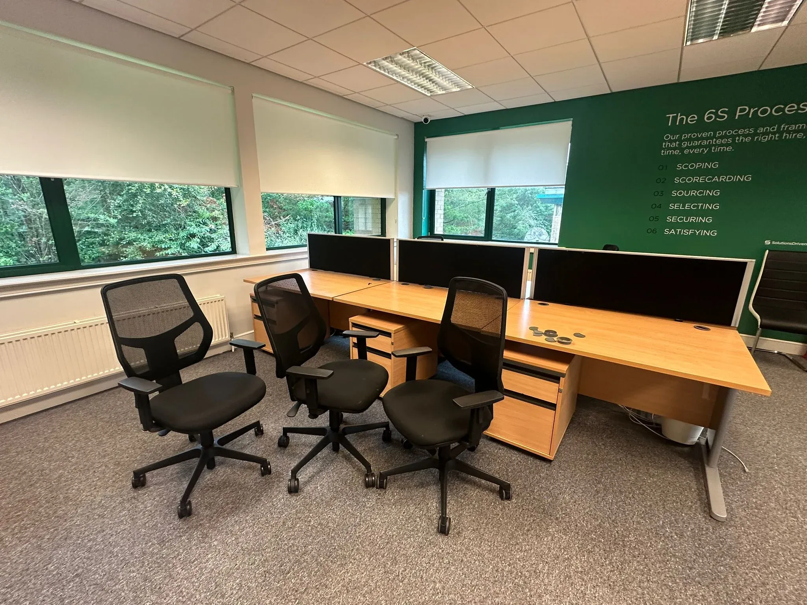
129:           </div>
130: 
131:           <h3>Responsible disposal</h3>
132:           <p>As a SEPA-registered waste carrier, we sort every load. Reusable items are donated to charity where possible, recyclable materials go to authorised facilities, and residual waste is disposed of legally and responsibly. We provide waste transfer documentation for commercial clients on request.</p>
133: 
134:           <h3>Why customers choose Junk Titanic</h3>
135:           <ul class="check-list">
136:             <li><strong>Upfront pricing</strong> — all-inclusive quote confirmed before we lift</li>
137:             <li><strong>Clean finish</strong> — we broom-sweep and take payment on completion</li>
138:             <li><strong>Same-day possible</strong> — subject to schedule and location</li>
139:             <li><strong>Fully insured</strong> — uniformed, trained operatives</li>
140:             <li><strong>Eco-friendly</strong> — recycling and charity diversion wherever practical</li>
141:           </ul>
142:         </article>
143: 
144:         <!-- ============ SIDEBAR ============ -->
145:         <aside class="service-aside" aria-label="Quick quote">
146:           <div class="quote-card">
147:             <h3>Get a fast quote</h3>
148:             <p>Send a photo on WhatsApp — we'll reply with an all-inclusive price, usually within minutes.</p>
149:             <a class="btn btn-wa btn-block" href="https://wa.me/447825646222" target="_blank" rel="noopener">📷 WhatsApp a photo</a>
150:             <a class="btn btn-primary btn-block" href="tel:07825646222">📞 07825 646222</a>
151:             <p class="small-print">No obligation. No hidden fees.</p>
152:           </div>
153: 
154:           <div class="aside-block">
155:             <h4>Related services</h4>
156:             <ul class="link-list">
157:               <li><a href="service.html">House Clearance</a></li>
158:               <li><a href="service.html">Commercial Waste</a></li>
159:               <li><a href="service.html">Office Clearance</a></li>
160:               <li><a href="service.html">Construction Waste</a></li>
161:               <li><a href="service.html">What We Take</a></li>
162:             </ul>
163:           </div>
164: 
165:           <div class="aside-block">
166:             <h4>Areas served</h4>
167:             <ul class="link-list">
168:               <li><a href="location.html">Rubbish Removal Glasgow</a></li>
169:               <li><a href="location.html">Rubbish Removal Edinburgh</a></li>
170:               <li><a href="location.html">Stirling</a></li>
171:               <li><a href="location.html">Livingston</a></li>
172:               <li><a href="location.html">See all areas →</a></li>
173:             </ul>
174:           </div>
175:         </aside>
176:       </div>
177:     </section>
178: 
179:     <!-- ============ PROCESS STRIP ============ -->
180:     <section class="section section-alt">
181:       <div class="container">
182:         <header class="section-head">
183:           <h2>How it works</h2>
184:         </header>
185:         <ol class="steps">
186:           <li>
187:             <span class="step-num" aria-hidden="true">1</span>
188:             <h3>Send a photo</h3>
189:             <p>WhatsApp us a picture of what needs to go. We'll reply with a competitive quote.</p>
190:           </li>
191:           <li>
192:             <span class="step-num" aria-hidden="true">2</span>
193:             <h3>Get an upfront price</h3>
194:             <p>All-inclusive, confirmed before we lift a finger. Prefer a site visit? We'll pop over.</p>
195:           </li>
196:           <li>
197:             <span class="step-num" aria-hidden="true">3</span>
198:             <h3>We clear &amp; sweep</h3>
199:             <p>Our crew loads everything, sweeps up, and takes payment. Job done.</p>
200:           </li>
201:         </ol>
202:       </div>
203:     </section>
204: 
205:     <!-- ============ FAQ ============ -->
206:     <section class="section">
207:       <div class="container narrow">
208:         <header class="section-head">
209:           <h2>Rubbish removal FAQs</h2>
210:         </header>
211:         <div class="faq">
212:           <details>
213:             <summary>How much does rubbish removal cost?</summary>
214:             <p>We charge by volume — how much space your items take up in the truck. There's a minimum charge for very small loads. Send a photo for an exact, all-inclusive quote before you book. See our <a href="pricing.html">pricing page</a> for volume examples.</p>
215:           </details>
216:           <details>
217:             <summary>Do you offer same-day collection?</summary>
218:             <p>Often, yes — depending on schedule and location. Call 07825 646222 and we'll tell you the earliest available slot.</p>
219:           </details>
220:           <details>
221:             <summary>Do you take everything?</summary>
222:             <p>Almost everything non-hazardous. We cannot accept chemicals, asbestos, oil drums, storage tanks or other hazardous waste. If in doubt, call us — our team will advise on safe disposal routes.</p>
223:           </details>
224:           <details>
225:             <summary>Do you cover my area?</summary>
226:             <p>We cover Glasgow, Edinburgh, Stirling, Livingston, Falkirk, Kilmarnock, Dunfermline, Dumbarton, Hamilton, Motherwell and the wider Central Belt. See our <a href="location.html">areas page</a> or call us to confirm.</p>
227:           </details>
228:           <details>
229:             <summary>What happens to my items?</summary>
230:             <p>We sort every load. Reusable items are donated to charity where possible, recyclable materials go to authorised facilities, and residual waste is disposed of responsibly. We aim to divert as much as possible from landfill.</p>
231:           </details>
232:         </div>
233:       </div>
234:     </section>
235: 
236:     <!-- ============ CTA BAND ============ -->
237:     <section class="cta-band">
238:       <div class="container cta-band-inner">
239:         <div>
240:           <h2>Ready to book?</h2>
241:           <p>Send a photo on WhatsApp and get an upfront price — usually within minutes.</p>
242:         </div>
243:         <div class="cta-row">
244:           <a class="btn btn-wa btn-lg" href="https://wa.me/447825646222" target="_blank" rel="noopener">📷 WhatsApp 07825 646222</a>
245:           <a class="btn btn-primary btn-lg" href="tel:07825646222">📞 Call now</a>
246:         </div>
247:       </div>
248:     </section>
249: 
250:   </main>
251: 
252:   <!-- ============ FOOTER ============ -->
253:   <footer class="site-footer">
254:     <div class="container footer-grid">
255:       <div>
256:         <h3>Junk Titanic</h3>
257:         <p>Fast, eco-friendly rubbish removal for homes, offices and gardens. Upfront pricing, same-day service, responsible disposal.</p>
258:         <p class="footer-badge">SEPA Registered · Fully Insured</p>
259:       </div>
260:       <div>
261:         <h4>Services</h4>
262:         <ul>
263:           <li><a href="service.html">Rubbish Removal</a></li>
264:           <li><a href="service.html">House Clearance</a></li>
265:           <li><a href="service.html">Commercial Waste</a></li>
266:           <li><a href="service.html">Office Clearance</a></li>
267:           <li><a href="service.html">Builders Waste</a></li>
268:           <li><a href="service.html">What We Take</a></li>
269:         </ul>
270:       </div>
271:       <div>
272:         <h4>Areas</h4>
273:         <ul>
274:           <li><a href="location.html">Glasgow</a></li>
275:           <li><a href="location.html">Edinburgh</a></li>
276:           <li><a href="location.html">Stirling</a></li>
277:           <li><a href="location.html">Livingston</a></li>
278:           <li><a href="location.html">Hamilton</a></li>
279:           <li><a href="location.html">Dunfermline</a></li>
280:         </ul>
281:       </div>
282:       <div>
283:         <h4>Contact</h4>
284:         <ul class="contact-list">
285:           <li><a href="tel:07825646222">07825 646222</a></li>
286:           <li><a href="https://wa.me/447825646222" target="_blank" rel="noopener">WhatsApp us</a></li>
287:           <li><a href="mailto:info@junktitanic.co.uk">info@junktitanic.co.uk</a></li>
288:         </ul>
289:         <p class="footer-addr">
290:           Junk Titanic<br />
291:           589 Lawmoor Street<br />
292:           Glasgow, G5 0TT
293:         </p>
294:       </div>
295:     </div>
296:     <div class="container footer-bottom">
297:       <p>© 2026 Junk Titanic. All rights reserved.</p>
298:       <ul>
299:         <li><a href="index.html">Terms</a></li>
300:         <li><a href="contact.html">Privacy</a></li>
301:       </ul>
302:     </div>
303:   </footer>
304: 
305:   <div class="call-bar" aria-label="Quick contact">
306:     <a class="call-bar-call" href="tel:07825646222">📞 Call</a>
307:     <a class="call-bar-wa" href="https://wa.me/447825646222" target="_blank" rel="noopener">📷 WhatsApp</a>
308:   </div>
309: 
310:   <script>
311:     const toggle = document.querySelector('.nav-toggle');
312:     const mobileNav = document.getElementById('mobile-nav');
313:     if (toggle && mobileNav) {
314:       toggle.addEventListener('click', () => {
315:         const open = toggle.getAttribute('aria-expanded') === 'true';
316:         toggle.setAttribute('aria-expanded', String(!open));
317:         mobileNav.hidden = open;
318:       });
319:     }
320:   </script>
321: </body>
322: </html>

(End of file - total 322 lines)
</content>
```

**Tool: read**

**Input:**
```json
{
  "filePath": "/home/joe/Desktop/projects/junktitan/junkdes/location.html"
}
```

**Output:**
```
<path>/home/joe/Desktop/projects/junktitan/junkdes/location.html</path>
<type>file</type>
<content>
1: <!DOCTYPE html>
2: <html lang="en-GB">
3: <head>
4:   <meta charset="UTF-8" />
5:   <meta name="viewport" content="width=device-width, initial-scale=1" />
6:   <title>Rubbish Removal Stirling | House &amp; Garden Clearance | Junk Titanic</title>
7:   <meta name="description" content="Rubbish removal in Stirling — house, garden and office clearance with same-day service and upfront pricing. SEPA-registered, fully insured. Call 07825 646222." />
8:   <link rel="stylesheet" href="styles.css" />
9: </head>
10: <body>
11: 
12:   <!-- ============ HEADER ============ -->
13:   <header class="site-header" role="banner">
14:     <div class="container header-inner">
15:       <a href="index.html" class="logo" aria-label="Junk Titanic home">
16:         
17:       </a>
18:       <nav class="main-nav" aria-label="Primary">
19:         <ul>
20:           <li><a href="service.html">Rubbish Removal</a></li>
21:           <li><a href="service.html">House Clearance</a></li>
22:           <li><a href="service.html">Commercial</a></li>
23:           <li><a href="pricing.html">Pricing</a></li>
24:           <li><a href="service.html">What We Take</a></li>
25:           <li><a href="location.html">Areas</a></li>
26:         </ul>
27:       </nav>
28:       <div class="header-actions">
29:         <a class="btn btn-ghost" href="tel:07825646222">07825 646222</a>
30:         <a class="btn btn-wa" href="https://wa.me/447825646222" target="_blank" rel="noopener">WhatsApp a photo</a>
31:         <button class="nav-toggle" aria-label="Open menu" aria-expanded="false" aria-controls="mobile-nav">☰</button>
32:       </div>
33:     </div>
34:     <nav id="mobile-nav" class="mobile-nav" aria-label="Mobile" hidden>
35:       <ul>
36:         <li><a href="service.html">Rubbish Removal</a></li>
37:         <li><a href="service.html">House Clearance</a></li>
38:         <li><a href="service.html">Commercial Waste</a></li>
39:         <li><a href="pricing.html">Pricing</a></li>
40:         <li><a href="service.html">What We Take</a></li>
41:         <li><a href="location.html">Areas We Cover</a></li>
42:         <li><a href="service.html">FAQs</a></li>
43:         <li><a href="contact.html">Contact</a></li>
44:       </ul>
45:     </nav>
46:   </header>
47: 
48:   <main>
49: 
50:     <!-- ============ HERO (location) ============ -->
51:     <section class="hero hero-sub">
52:       <div class="container hero-grid">
53:         <div class="hero-copy">
54:           <nav class="breadcrumb" aria-label="Breadcrumb">
55:             <ol>
56:               <li><a href="index.html">Home</a></li>
57:               <li><a href="location.html">Areas</a></li>
58:               <li aria-current="page">Stirling</li>
59:             </ol>
60:           </nav>
61:           <p class="eyebrow">Local service · Stirling &amp; Forth Valley</p>
62:           <h1>Rubbish Removal in Stirling</h1>
63:           <p class="lede">
64:             House, garden and office clearances across Stirling, Bridge of Allan, Dunblane,
65:             Bannockburn and the wider Forth Valley — with same-day collection where available
66:             and upfront, all-inclusive pricing.
67:           </p>
68:           <div class="cta-row">
69:             <a class="btn btn-wa btn-lg" href="https://wa.me/447825646222?text=Hi%2C%20I%27d%20like%20a%20rubbish%20removal%20quote%20in%20Stirling" target="_blank" rel="noopener">
70:               📷 Send a photo on WhatsApp
71:             </a>
72:             <a class="btn btn-primary btn-lg" href="tel:07825646222">📞 Call 07825 646222</a>
73:           </div>
74:           <ul class="trust-strip" aria-label="Trust signals">
75:             <li>Stirling &amp; Forth Valley</li>
76:             <li>SEPA registered</li>
77:             <li>Same-day possible</li>
78:           </ul>
79:         </div>
80:         <div class="hero-media">
81:           <!-- MEDIA: hero image — alt="Junk Titanic van in Stirling with a cleared driveway behind" -->
82:           <div class="hero-visual" role="img" aria-label="Junk Titanic van operating in Stirling">
83:             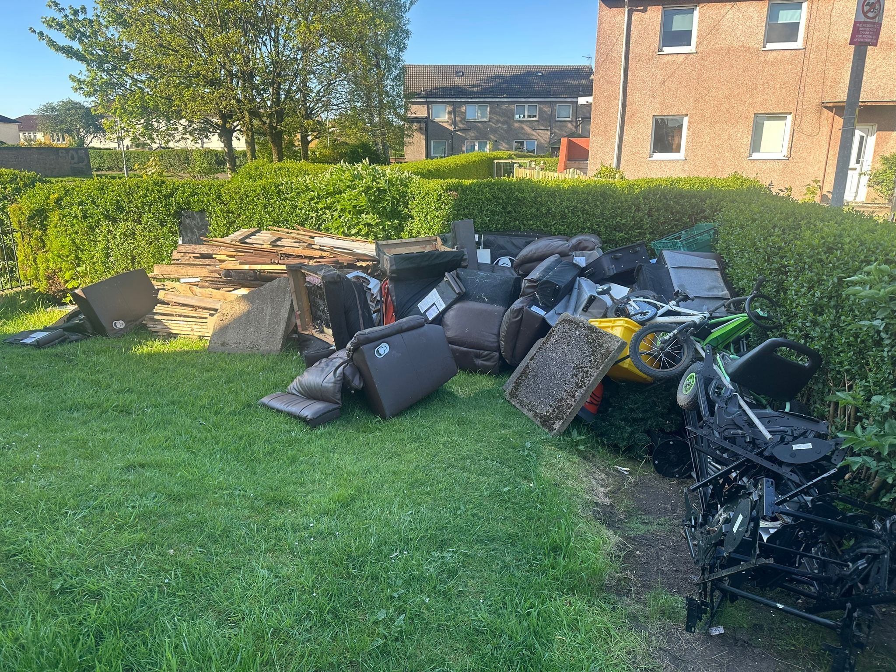
84:             <div class="hero-badge">
85:               <strong>Stirling</strong>
86:               <span>Fast local collection and uplift across the Forth Valley.</span>
87:             </div>
88:           </div>
89:         </div>
90:       </div>
91:     </section>
92: 
93:     <!-- ============ LOCAL INTRO ============ -->
94:     <section class="section">
95:       <div class="container narrow">
96:         <header class="section-head left">
97:           <h2>Local rubbish removal for Stirling homes and businesses</h2>
98:         </header>
99:         <p>Junk Titanic regularly serves homeowners, landlords and businesses across Stirling and the Forth Valley — from the city centre and Riverside out to Bridge of Allan, Dunblane, Bannockburn, St Ninians, Causewayhead and Cambusbarron. Whether you're clearing a flat near the castle, emptying a garage in Bannockburn, or preparing a rental property for new tenants, our uniformed crew will collect, load and sweep up — often the same day.</p>
100: 
101:         <p>Stirling's mix of older tenement flats, modern estates and rural properties means we're used to every access scenario: tight stairs, restricted parking, long driveways and everything in between. If you're unsure whether we can reach an item, send us a photo — we'll tell you straight.</p>
102: 
103:         <!-- MEDIA: local area photo — alt="Victorian tenement close in Stirling city centre" -->
104:         <div class="feature-image" role="img" aria-label="House clearance in a local Stirling property">
105:           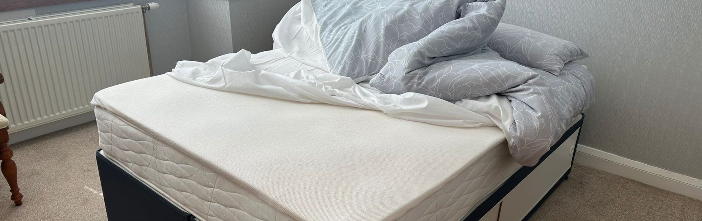
106:         </div>
107:       </div>
108:     </section>
109: 
110:     <!-- ============ SERVICES IN STIRLING ============ -->
111:     <section class="section section-alt">
112:       <div class="container">
113:         <header class="section-head">
114:           <h2>Services available in Stirling</h2>
115:           <p>Same crew, same pricing model — tailored to each job.</p>
116:         </header>
117:         <div class="cards">
118:           <a class="card" href="service.html">
119:             <div class="card-thumb">
120:               
121:             </div>
122:             <h3>House Clearance</h3>
123:             <p>Full or partial clears — moving, downsizing, bereavement or rental turnover.</p>
124:             <span class="card-link">Learn more →</span>
125:           </a>
126:           <a class="card" href="service.html">
127:             <div class="card-thumb">
128:               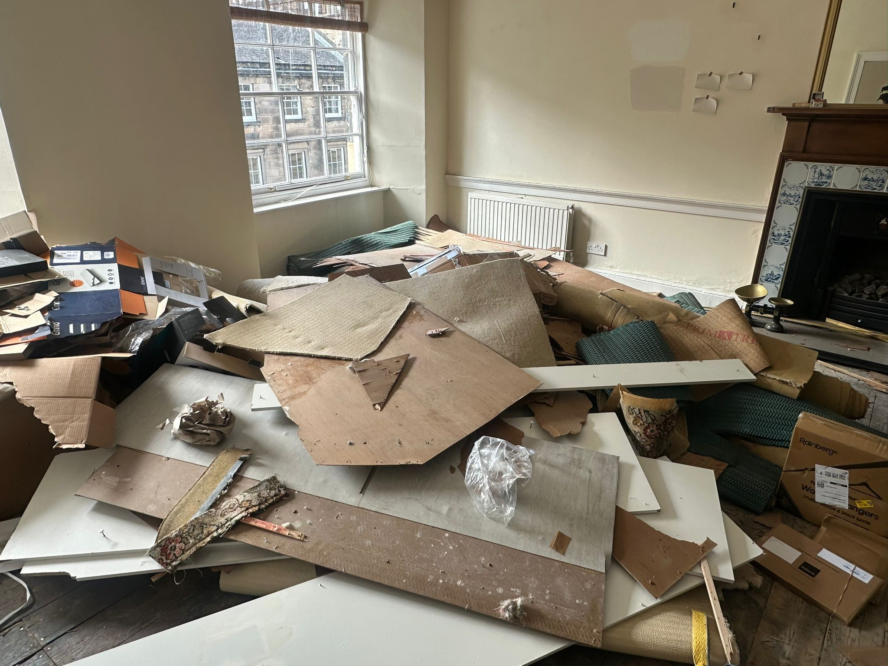
129:             </div>
130:             <h3>Rubbish Removal</h3>
131:             <p>Bulky items, appliances, furniture and general household junk.</p>
132:             <span class="card-link">Learn more →</span>
133:           </a>
134:           <a class="card" href="service.html">
135:             <div class="card-thumb">
136:               
137:             </div>
138:             <h3>Garden Clearance</h3>
139:             <p>Sheds, decking, fencing, green waste and outdoor clutter.</p>
140:             <span class="card-link">Learn more →</span>
141:           </a>
142:           <a class="card" href="service.html">
143:             <div class="card-thumb">
144:               
145:             </div>
146:             <h3>Commercial &amp; Office</h3>
147:             <p>Desks, IT, confidential shredding, fit-out debris — minimal disruption.</p>
148:             <span class="card-link">Learn more →</span>
149:           </a>
150:         </div>
151:       </div>
152:     </section>
153: 
154:     <!-- ============ COVERAGE ============ -->
155:     <section class="section">
156:       <div class="container">
157:         <header class="section-head">
158:           <h2>Stirling areas we cover</h2>
159:         </header>
160:         <div class="areas-grid">
161:           <div>
162:             <h3>Stirling city</h3>
163:             <p>City Centre · Riverside · Top of the Town · Raploch · Cornton · Causewayhead</p>
164:           </div>
165:           <div>
166:             <h3>Nearby towns</h3>
167:             <p>Bridge of Allan · Dunblane · Bannockburn · St Ninians · Cambusbarron · Fallin</p>
168:           </div>
169:           <div>
170:             <h3>Wider Forth Valley</h3>
171:             <p>Falkirk · Alloa · Grangemouth · Menstrie · Tullibody · Clackmannanshire</p>
172:           </div>
173:         </div>
174: 
175:         <p class="center-note">
176:           Not sure if we cover your street? <a href="tel:07825646222">Call us</a> or <a href="https://wa.me/447825646222" target="_blank" rel="noopener">send a message on WhatsApp</a>.
177:         </p>
178: 
179:         <div class="areas-media">
180:           <!-- MEDIA: Stirling map — alt="Map showing Junk Titanic rubbish removal coverage around Stirling" -->
181:           <div class="feature-image" role="img" aria-label="Junk Titanic team on a local Stirling clearance job">
182:             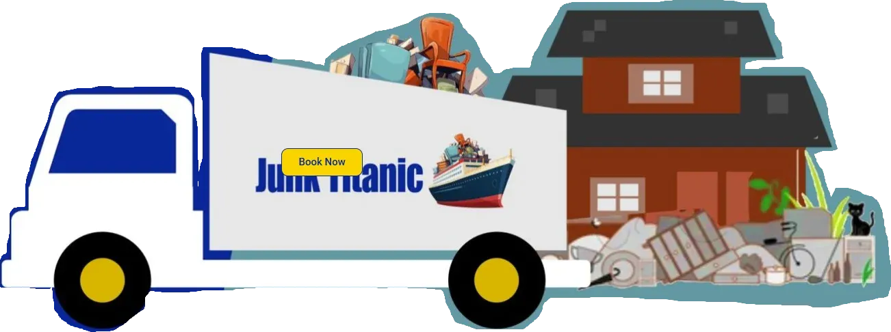
183:           </div>
184:         </div>
185:       </div>
186:     </section>
187: 
188:     <!-- ============ LOCAL FAQ ============ -->
189:     <section class="section section-alt">
190:       <div class="container narrow">
191:         <header class="section-head">
192:           <h2>Stirling rubbish removal FAQs</h2>
193:         </header>
194:         <div class="faq">
195:           <details>
196:             <summary>Do you charge extra for Stirling?</summary>
197:             <p>No — Stirling is within our standard Central Belt coverage. Pricing is by volume, with a minimum charge for very small loads. Send a photo for an exact quote.</p>
198:           </details>
199:           <details>
200:             <summary>Can you collect from a tenement flat in the city centre?</summary>
201:             <p>Yes. We routinely clear flats with tight stairs and restricted parking. Send us a photo and mention any access restrictions — we'll plan the crew accordingly.</p>
202:           </details>
203:           <details>
204:             <summary>Do you offer same-day collection in Stirling?</summary>
205:             <p>Often, yes. Call 07825 646222 and we'll tell you the earliest slot. Same-day is subject to schedule and location.</p>
206:           </details>
207:           <details>
208:             <summary>Do you work with landlords in Stirling?</summary>
209:             <p>Yes — we regularly help landlords and letting agents clear properties between tenants, including full house clearances and furniture removal. Call us to discuss recurring or short-notice jobs.</p>
210:           </details>
211:           <details>
212:             <summary>What about garden waste?</summary>
213:             <p>We collect green waste, hedge clippings, fence panels, decking, sheds and old garden furniture. If you have large quantities of soil, rubble or heavy building materials, please call first so we can confirm access and pricing.</p>
214:           </details>
215:         </div>
216:       </div>
217:     </section>
218: 
219:     <!-- ============ CTA BAND ============ -->
220:     <section class="cta-band">
221:       <div class="container cta-band-inner">
222:         <div>
223:           <h2>Book a Stirling collection</h2>
224:           <p>Send a photo on WhatsApp and we'll reply with an upfront price.</p>
225:         </div>
226:         <div class="cta-row">
227:           <a class="btn btn-wa btn-lg" href="https://wa.me/447825646222" target="_blank" rel="noopener">📷 WhatsApp 07825 646222</a>
228:           <a class="btn btn-primary btn-lg" href="tel:07825646222">📞 Call now</a>
229:         </div>
230:       </div>
231:     </section>
232: 
233:   </main>
234: 
235:   <!-- ============ FOOTER ============ -->
236:   <footer class="site-footer">
237:     <div class="container footer-grid">
238:       <div>
239:         <h3>Junk Titanic</h3>
240:         <p>Fast, eco-friendly rubbish removal for homes, offices and gardens. Upfront pricing, same-day service, responsible disposal.</p>
241:         <p class="footer-badge">SEPA Registered · Fully Insured</p>
242:       </div>
243:       <div>
244:         <h4>Services</h4>
245:         <ul>
246:           <li><a href="service.html">Rubbish Removal</a></li>
247:           <li><a href="service.html">House Clearance</a></li>
248:           <li><a href="service.html">Commercial Waste</a></li>
249:           <li><a href="service.html">Office Clearance</a></li>
250:           <li><a href="service.html">Builders Waste</a></li>
251:           <li><a href="service.html">What We Take</a></li>
252:         </ul>
253:       </div>
254:       <div>
255:         <h4>Areas</h4>
256:         <ul>
257:           <li><a href="location.html">Glasgow</a></li>
258:           <li><a href="location.html">Edinburgh</a></li>
259:           <li><a href="location.html">Stirling</a></li>
260:           <li><a href="location.html">Livingston</a></li>
261:           <li><a href="location.html">Hamilton</a></li>
262:           <li><a href="location.html">Dunfermline</a></li>
263:         </ul>
264:       </div>
265:       <div>
266:         <h4>Contact</h4>
267:         <ul class="contact-list">
268:           <li><a href="tel:07825646222">07825 646222</a></li>
269:           <li><a href="https://wa.me/447825646222" target="_blank" rel="noopener">WhatsApp us</a></li>
270:           <li><a href="mailto:info@junktitanic.co.uk">info@junktitanic.co.uk</a></li>
271:         </ul>
272:         <p class="footer-addr">
273:           Junk Titanic<br />
274:           589 Lawmoor Street<br />
275:           Glasgow, G5 0TT
276:         </p>
277:       </div>
278:     </div>
279:     <div class="container footer-bottom">
280:       <p>© 2026 Junk Titanic. All rights reserved.</p>
281:       <ul>
282:         <li><a href="index.html">Terms</a></li>
283:         <li><a href="contact.html">Privacy</a></li>
284:       </ul>
285:     </div>
286:   </footer>
287: 
288:   <div class="call-bar" aria-label="Quick contact">
289:     <a class="call-bar-call" href="tel:07825646222">📞 Call</a>
290:     <a class="call-bar-wa" href="https://wa.me/447825646222" target="_blank" rel="noopener">📷 WhatsApp</a>
291:   </div>
292: 
293:   <script>
294:     const toggle = document.querySelector('.nav-toggle');
295:     const mobileNav = document.getElementById('mobile-nav');
296:     if (toggle && mobileNav) {
297:       toggle.addEventListener('click', () => {
298:         const open = toggle.getAttribute('aria-expanded') === 'true';
299:         toggle.setAttribute('aria-expanded', String(!open));
300:         mobileNav.hidden = open;
301:       });
302:     }
303:   </script>
304: </body>
305: </html>

(End of file - total 305 lines)
</content>
```

**Tool: read**

**Input:**
```json
{
  "filePath": "/home/joe/Desktop/projects/junktitan/junkdes/contact.html"
}
```

**Output:**
```
<path>/home/joe/Desktop/projects/junktitan/junkdes/contact.html</path>
<type>file</type>
<content>
1: <!DOCTYPE html>
2: <html lang="en-GB">
3: <head>
4:   <meta charset="UTF-8" />
5:   <meta name="viewport" content="width=device-width, initial-scale=1" />
6:   <title>Contact &amp; Book | Junk Titanic</title>
7:   <meta name="description" content="Contact Junk Titanic — call 07825 646222, WhatsApp a photo for a fast quote, or book online. Rubbish removal and house clearance across Central Scotland." />
8:   <link rel="stylesheet" href="styles.css" />
9: </head>
10: <body>
11: 
12:   <!-- ============ HEADER ============ -->
13:   <header class="site-header" role="banner">
14:     <div class="container header-inner">
15:       <a href="index.html" class="logo" aria-label="Junk Titanic home">
16:         
17:       </a>
18:       <nav class="main-nav" aria-label="Primary">
19:         <ul>
20:           <li><a href="service.html">Rubbish Removal</a></li>
21:           <li><a href="service.html">House Clearance</a></li>
22:           <li><a href="service.html">Commercial</a></li>
23:           <li><a href="pricing.html">Pricing</a></li>
24:           <li><a href="service.html">What We Take</a></li>
25:           <li><a href="location.html">Areas</a></li>
26:         </ul>
27:       </nav>
28:       <div class="header-actions">
29:         <a class="btn btn-ghost" href="tel:07825646222">07825 646222</a>
30:         <a class="btn btn-wa" href="https://wa.me/447825646222" target="_blank" rel="noopener">WhatsApp a photo</a>
31:         <button class="nav-toggle" aria-label="Open menu" aria-expanded="false" aria-controls="mobile-nav">☰</button>
32:       </div>
33:     </div>
34:     <nav id="mobile-nav" class="mobile-nav" aria-label="Mobile" hidden>
35:       <ul>
36:         <li><a href="service.html">Rubbish Removal</a></li>
37:         <li><a href="service.html">House Clearance</a></li>
38:         <li><a href="service.html">Commercial Waste</a></li>
39:         <li><a href="pricing.html">Pricing</a></li>
40:         <li><a href="service.html">What We Take</a></li>
41:         <li><a href="location.html">Areas We Cover</a></li>
42:         <li><a href="service.html">FAQs</a></li>
43:         <li><a href="contact.html">Contact</a></li>
44:       </ul>
45:     </nav>
46:   </header>
47: 
48:   <main>
49: 
50:     <!-- ============ HERO ============ -->
51:     <section class="hero hero-sub">
52:       <div class="container narrow-copy">
53:         <nav class="breadcrumb" aria-label="Breadcrumb">
54:           <ol>
55:             <li><a href="index.html">Home</a></li>
56:             <li aria-current="page">Contact</li>
57:           </ol>
58:         </nav>
59:         <p class="eyebrow">Fast response · No obligation</p>
60:         <h1>Get in touch or book a collection</h1>
61:         <p class="lede">
62:           The fastest way to a price is a photo on WhatsApp. Prefer to fill in a quick form?
63:           Use the booking box below — we'll reply with an upfront quote.
64:         </p>
65:       </div>
66:     </section>
67: 
68:     <!-- ============ CONTACT OPTIONS ============ -->
69:     <section class="section">
70:       <div class="container">
71:         <div class="contact-options">
72:           <a class="contact-tile contact-tile-wa" href="https://wa.me/447825646222" target="_blank" rel="noopener">
73:             <div class="contact-icon" aria-hidden="true">📷</div>
74:             <h3>WhatsApp a photo</h3>
75:             <p>The fastest way to a quote. Send a picture of the items and we'll reply with an all-inclusive price — usually within minutes.</p>
76:             <span class="contact-action">Open WhatsApp →</span>
77:           </a>
78:           <a class="contact-tile contact-tile-call" href="tel:07825646222">
79:             <div class="contact-icon" aria-hidden="true">📞</div>
80:             <h3>Call us</h3>
81:             <p>Prefer to talk it through? Call 07825 646222 — we can advise on pricing, access, and the earliest available slot.</p>
82:             <span class="contact-action">Call 07825 646222 →</span>
83:           </a>
84:           <a class="contact-tile contact-tile-email" href="mailto:info@junktitanic.co.uk">
85:             <div class="contact-icon" aria-hidden="true">✉️</div>
86:             <h3>Email</h3>
87:             <p>For detailed enquiries, landlord or commercial contracts, or invoice requests — email us and we'll reply on the next business day.</p>
88:             <span class="contact-action">info@junktitanic.co.uk →</span>
89:           </a>
90:         </div>
91:       </div>
92:     </section>
93: 
94:     <!-- ============ BOOKING FORM ============ -->
95:     <section class="section section-alt" id="book">
96:       <div class="container narrow">
97:         <header class="section-head">
98:           <h2>Book a collection</h2>
99:           <p>Short and simple. All we need is what you want cleared, where, and when — we'll do the rest.</p>
100:         </header>
101: 
102:         <form class="booking-form" action="#" method="post" novalidate>
103:           <!-- Step 1: What -->
104:           <fieldset>
105:             <legend>What needs clearing?</legend>
106:             <label class="field-label" for="service">Service type</label>
107:             <select id="service" name="service" required>
108:               <option value="">Choose a service…</option>
109:               <option value="house-clearance">House clearance</option>
110:               <option value="rubbish-removal">Rubbish removal</option>
111:               <option value="garden-clearance">Garden clearance</option>
112:               <option value="office-clearance">Office / commercial clearance</option>
113:               <option value="construction">Construction / renovation waste</option>
114:               <option value="single-item">Single item collection</option>
115:               <option value="other">Something else</option>
116:             </select>
117: 
118:             <label class="field-label" for="details">Tell us a bit about the job</label>
119:             <textarea id="details" name="details" rows="3" placeholder="e.g. Old sofa, washing machine and several bags of general rubbish from a first-floor flat." required></textarea>
120: 
121:             <label class="field-label" for="photo">Photo (optional but helpful)</label>
122:             <input id="photo" name="photo" type="file" accept="image/*" capture="environment" />
123:             <p class="field-help">A photo of the items means we can quote accurately first time.</p>
124:           </fieldset>
125: 
126:           <!-- Step 2: Where -->
127:           <fieldset>
128:             <legend>Where are you?</legend>
129:             <label class="field-label" for="postcode">Postcode</label>
130:             <input id="postcode" name="postcode" type="text" inputmode="text" autocomplete="postal-code" placeholder="e.g. FK8 1AA" required />
131: 
132:             <label class="field-label" for="address">Address <span class="optional">(optional)</span></label>
133:             <input id="address" name="address" type="text" autocomplete="street-address" placeholder="Street and number" />
134:           </fieldset>
135: 
136:           <!-- Step 3: When -->
137:           <fieldset>
138:             <legend>When suits you?</legend>
139:             <div class="radio-row">
140:               <label class="radio">
141:                 <input type="radio" name="when" value="asap" checked />
142:                 <span>ASAP (same-day if available)</span>
143:               </label>
144:               <label class="radio">
145:                 <input type="radio" name="when" value="this-week" />
146:                 <span>This week</span>
147:               </label>
148:               <label class="radio">
149:                 <input type="radio" name="when" value="flexible" />
150:                 <span>Flexible</span>
151:               </label>
152:             </div>
153:             <label class="field-label" for="date">Or pick a date <span class="optional">(optional)</span></label>
154:             <input id="date" name="date" type="date" />
155:           </fieldset>
156: 
157:           <!-- Step 4: Contact -->
158:           <fieldset>
159:             <legend>Your details</legend>
160:             <div class="two-field-row">
161:               <div>
162:                 <label class="field-label" for="name">Name</label>
163:                 <input id="name" name="name" type="text" autocomplete="name" required />
164:               </div>
165:               <div>
166:                 <label class="field-label" for="phone">Phone</label>
167:                 <input id="phone" name="phone" type="tel" autocomplete="tel" placeholder="07…" required />
168:               </div>
169:             </div>
170:             <label class="field-label" for="email">Email <span class="optional">(optional)</span></label>
171:             <input id="email" name="email" type="email" autocomplete="email" />
172:           </fieldset>
173: 
174:           <div class="form-submit">
175:             <button type="submit" class="btn btn-primary btn-lg">Send booking request</button>
176:             <p class="small-print">We'll reply with an upfront quote. No obligation.</p>
177:           </div>
178:         </form>
179:       </div>
180:     </section>
181: 
182:     <!-- ============ CONTACT DETAILS ============ -->
183:     <section class="section">
184:       <div class="container narrow">
185:         <header class="section-head">
186:           <h2>Junk Titanic</h2>
187:         </header>
188:         <div class="contact-details">
189:           <div>
190:             <h3>Contact</h3>
191:             <ul class="contact-list">
192:               <li><a href="tel:07825646222">07825 646222</a></li>
193:               <li><a href="https://wa.me/447825646222" target="_blank" rel="noopener">WhatsApp us</a></li>
194:               <li><a href="mailto:info@junktitanic.co.uk">info@junktitanic.co.uk</a></li>
195:             </ul>
196:           </div>
197:           <div>
198:             <h3>Address</h3>
199:             <address>
200:               Junk Titanic<br />
201:               589 Lawmoor Street<br />
202:               Glasgow<br />
203:               G5 0TT
204:             </address>
205:           </div>
206:           <div>
207:             <h3>Opening hours</h3>
208:             <p>Monday – Sunday<br />7:00 am – 9:00 pm<br /><span class="small-print">Summer evening slots available where possible.</span></p>
209:           </div>
210:         </div>
211: 
212:         <div class="areas-media">
213:           <div class="feature-image" role="img" aria-label="Junk Titanic team working on a Glasgow rubbish removal project">
214:             
215:           </div>
216:         </div>
217:       </div>
218:     </section>
219: 
220:     <!-- ============ CTA BAND ============ -->
221:     <section class="cta-band">
222:       <div class="container cta-band-inner">
223:         <div>
224:           <h2>Need it gone fast?</h2>
225:           <p>WhatsApp a photo for a same-day quote.</p>
226:         </div>
227:         <div class="cta-row">
228:           <a class="btn btn-wa btn-lg" href="https://wa.me/447825646222" target="_blank" rel="noopener">📷 WhatsApp 07825 646222</a>
229:           <a class="btn btn-primary btn-lg" href="tel:07825646222">📞 Call now</a>
230:         </div>
231:       </div>
232:     </section>
233: 
234:   </main>
235: 
236:   <!-- ============ FOOTER ============ -->
237:   <footer class="site-footer">
238:     <div class="container footer-grid">
239:       <div>
240:         <h3>Junk Titanic</h3>
241:         <p>Fast, eco-friendly rubbish removal for homes, offices and gardens. Upfront pricing, same-day service, responsible disposal.</p>
242:         <p class="footer-badge">SEPA Registered · Fully Insured</p>
243:       </div>
244:       <div>
245:         <h4>Services</h4>
246:         <ul>
247:           <li><a href="service.html">Rubbish Removal</a></li>
248:           <li><a href="service.html">House Clearance</a></li>
249:           <li><a href="service.html">Commercial Waste</a></li>
250:           <li><a href="service.html">Office Clearance</a></li>
251:           <li><a href="service.html">Builders Waste</a></li>
252:           <li><a href="service.html">What We Take</a></li>
253:         </ul>
254:       </div>
255:       <div>
256:         <h4>Areas</h4>
257:         <ul>
258:           <li><a href="location.html">Glasgow</a></li>
259:           <li><a href="location.html">Edinburgh</a></li>
260:           <li><a href="location.html">Stirling</a></li>
261:           <li><a href="location.html">Livingston</a></li>
262:           <li><a href="location.html">Hamilton</a></li>
263:           <li><a href="location.html">Dunfermline</a></li>
264:         </ul>
265:       </div>
266:       <div>
267:         <h4>Contact</h4>
268:         <ul class="contact-list">
269:           <li><a href="tel:07825646222">07825 646222</a></li>
270:           <li><a href="https://wa.me/447825646222" target="_blank" rel="noopener">WhatsApp us</a></li>
271:           <li><a href="mailto:info@junktitanic.co.uk">info@junktitanic.co.uk</a></li>
272:         </ul>
273:         <p class="footer-addr">
274:           Junk Titanic<br />
275:           589 Lawmoor Street<br />
276:           Glasgow, G5 0TT
277:         </p>
278:       </div>
279:     </div>
280:     <div class="container footer-bottom">
281:       <p>© 2026 Junk Titanic. All rights reserved.</p>
282:       <ul>
283:         <li><a href="index.html">Terms</a></li>
284:         <li><a href="contact.html">Privacy</a></li>
285:       </ul>
286:     </div>
287:   </footer>
288: 
289:   <div class="call-bar" aria-label="Quick contact">
290:     <a class="call-bar-call" href="tel:07825646222">📞 Call</a>
291:     <a class="call-bar-wa" href="https://wa.me/447825646222" target="_blank" rel="noopener">📷 WhatsApp</a>
292:   </div>
293: 
294:   <script>
295:     const toggle = document.querySelector('.nav-toggle');
296:     const mobileNav = document.getElementById('mobile-nav');
297:     if (toggle && mobileNav) {
298:       toggle.addEventListener('click', () => {
299:         const open = toggle.getAttribute('aria-expanded') === 'true';
300:         toggle.setAttribute('aria-expanded', String(!open));
301:         mobileNav.hidden = open;
302:       });
303:     }
304:   </script>
305: </body>
306: </html>

(End of file - total 306 lines)
</content>
```

---

## Assistant (Build · Big Pickle · 15.5s)

**Tool: read**

**Input:**
```json
{
  "filePath": "/home/joe/Desktop/projects/junktitan/junkdes/images/pricing-image to help with the pricing page as well? Or wait - let me look up the actual files again. Also pricing folder has vehicle image. Let me look at all images."
}
```

**Error:**
```
File not found: /home/joe/Desktop/projects/junktitan/junkdes/images/pricing-image to help with the pricing page as well? Or wait - let me look up the actual files again. Also pricing folder has vehicle image. Let me look at all images.
```

**Tool: bash**

**Input:**
```json
{
  "command": "ls -lh /home/joe/Desktop/projects/junktitan/junkdes/images/ | head -30"
}
```

**Output:**
```
total 25M
-rw-rw-r-- 1 joe joe  23K Oct 25 11:54 404.png
-rw-rw-r-- 1 joe joe  29K Oct 25 11:54 about-image2-1.png
-rw-rw-r-- 1 joe joe  79K Oct 25 11:54 app-dev.png
-rw-rw-r-- 1 joe joe  44K Oct 25 11:54 author.png
-rw-rw-r-- 1 joe joe  24K Oct 25 12:14 bg-page-header.jpg
-rw-rw-r-- 1 joe joe 6.2K Oct 25 11:54 c-logo6-1.png
-rw-rw-r-- 1 joe joe 166K Oct 25 12:15 construction-waste-removal-1024x768.webp
-rw-rw-r-- 1 joe joe 7.0K Oct 25 12:15 construction-waste-removal-150x150.webp
-rw-rw-r-- 1 joe joe 299K Oct 25 12:15 construction-waste-removal-1536x1152.webp
-rw-rw-r-- 1 joe joe  19K Oct 25 12:15 construction-waste-removal-300x225.webp
-rw-rw-r-- 1 joe joe  74K Oct 25 12:15 construction-waste-removal-750x500.webp
-rw-rw-r-- 1 joe joe 119K Oct 25 12:15 construction-waste-removal-760x760.webp
-rw-rw-r-- 1 joe joe  96K Oct 25 12:15 construction-waste-removal-768x576.webp
-rw-rw-r-- 1 joe joe  84K Oct 25 12:15 construction-waste-removal-870x520.webp
-rw-rw-r-- 1 joe joe 158K Oct 25 12:15 Construction-Waste-Removal-Junk-Titanic-rbov2hc9bid1qbk82o21acjiynae9t718ssehbqu7k.webp
-rw-rw-r-- 1 joe joe 158K Oct 25 12:15 construction-waste-removal-raqywxw0wjlxjruydm0v4szx3iooxbufdk6x28ky9c.webp
-rw-rw-r-- 1 joe joe 537K Oct 25 12:15 construction-waste-removal.webp
-rw-rw-r-- 1 joe joe  45K Oct 25 12:14 cropped-junktitanic-icon-180x180.png
-rw-rw-r-- 1 joe joe  51K Oct 25 12:14 cropped-junktitanic-icon-192x192.png
-rw-rw-r-- 1 joe joe  93K Oct 25 12:14 cropped-junktitanic-icon-270x270.png
-rw-rw-r-- 1 joe joe 2.1K Oct 25 12:14 cropped-junktitanic-icon-32x32.png
-rw-rw-r-- 1 joe joe  15K Oct 25 12:15 cropped-Logo-1024x292.webp
-rw-rw-r-- 1 joe joe  24K Oct 25 12:15 cropped-Logo-1536x439.webp
-rw-rw-r-- 1 joe joe 3.8K Oct 25 12:15 cropped-Logo-300x86.webp
-rw-rw-r-- 1 joe joe  11K Oct 25 12:15 cropped-Logo-768x219.webp
-rw-rw-r-- 1 joe joe  28K Oct 25 12:15 cropped-Logo.webp
-rw-rw-r-- 1 joe joe  65K Oct 25 12:15 electrical-appliances-and-white-goods-recycling-r9ks301bavmpnsma59riv3cwgtale97muvsd323xio.webp
-rw-rw-r-- 1 joe joe 142K Oct 25 12:15 Furniture-Removal-Junk-Titanic-1024x768.webp
-rw-rw-r-- 1 joe joe 265K Oct 25 12:15 Furniture-Removal-Junk-Titanic-1536x1152.webp

```

---

## Assistant (Build · Big Pickle)

---

## User

the pricing simple car image is in a folder in the junkdes called pricing

---

